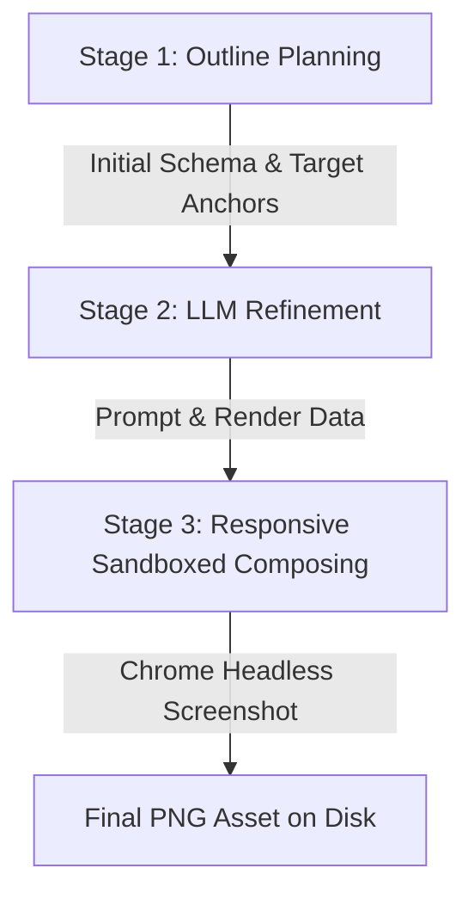

# Multi-Agent Conflict Scenario Generation Pipeline

This document outlines the multi-stage, hierarchical planning and generation pipeline for compiling conflict-focused Multi-modal temporal scenarios (Conflict-VLM) from a single high-level JSON seed definition.

To scale scenarios to large round counts (e.g., 20 to 100 rounds) without exceeding LLM output token limits or suffering narrative degradation, the pipeline utilizes a **Hierarchical Phased Outline Planning** strategy with rolling-window expansions.

---

## Pipeline Overview

The scenario generation follows an 8-stage lifecycle:

```text
                     +-----------------------+
                     |  Scenario Seed JSON   |
                     +-----------+-----------+
                                 |
                                 v
                     +-----------------------+
                     | Stage 1: Outline Plan |
                     |  - 1a: Screenplay     |  (conflict_layer0a_screenplay)
                     |  - 1b: Timeline Beat  |  (conflict_layer0b_timeline)
                     |  - 1c: Resource Plans |  (conflict_layer0c_plans)
                     +-----------+-----------+
                                 |
                                 v
                     +-----------------------+
                     | Stage 2: Subagents &  |
                     | Interaction Rules     |  (conflict_layer1_agents)
                     |                       |  (conflict_layer1_interactions)
                     +-----------+-----------+
                                 |
                                 v
                     +-----------------------+
                     | Stage 3: Background   |
                     | Workspace Setup       |  (conflict_layer1b_files/sessions/assets)
                     +-----------+-----------+
                                 |
                                 v
            +<───────────────────┴───────────────────┐
            │                                        │
            v (Loop from round 1 to N)               │
    [ New Phase Boundary? ]                          │
      /                 \                            │
    Yes                  No                          │
    /                      \                         │
   v                        v                        │
 +-------------------+    +----------------------+   │
 | Stage 4: Phase    |    | Stage 5: Progressive |   │
 | Expansion         |    | Round Generation     |   │
 | (L0 Expand Phase) |    | (Layer 3 Round Spec) |   │
 +---------+---------+    +----------+-----------+   │
           │                         │               │
           └───────────┬─────────────┘               │
                       │                             │
                       v                             │
             [ Next Round Loop? ]  ───(Yes)──────────┘
                       │
                     (No)
                       │
                       v
                     +-----------------------+
                     | Stage 6: Consistency  |
                     | Auditing & Repair     |  (llm_auditor / consistency_layer)
                     |  - 6a: Inst vs Grader |  (audit_instruction_checker)
                     |  - 6b: Anchor Trace   |  (audit_anchor_discoverability)
                     |  - 6c: Telemetry Align|  (audit_telemetry_alignment)
                     |  - 6d: Rule 6 Pruning |  (Rule 6 Grader Cleaning)
                     +-----------+-----------+
                                 |
                                 v
                     +-----------------------+
                     | Stage 7: Asset Refine |
                     |  - 7a: Matplotlib Code|  (vlm_asset_detail - Matplotlib)
                     |  - 7b: Scene Prompt   |  (vlm_asset_detail - Scene Image)
                     |  - 7c: CSS Composing  |  (compose_vlm_html layout composition)
                     +-----------+-----------+
                                 |
                                 v
                     +-----------------------+
                     | Stage 8: Compilation  |  (Sandbox & Chrome Screenshot)
                     +-----------+-----------+
                                 |
                                 v
                     +-----------------------+
                     | Final Scenario Spec   |  (scenario.json & Spec Package)
                     +-----------------------+
```

---

## Design Principle & Failure-Mode Map

Almost every safeguard in this pipeline exists to defeat a specific, recurring
**generator-model failure mode**. Those failure modes (labelled **M1–M14**), with
quantified evidence from real runs, are catalogued in
[`docs/analysis/generator-failure-modes.md`](docs/analysis/generator-failure-modes.md);
this section maps each pipeline design back to the problem it solves, so the *why*
sits next to the *what*. Individual stages below carry a short **Why / fixes (M#)**
note and cross-reference that catalog for depth.

**Governing principle — _normalize what you can, retry what you must._** Mechanical
mistakes (leaked IDs, empty content, mis-keyed effect/step shapes, path-like asset
ids) are repaired **deterministically in code**, because retries cost API calls and
can exhaust the budget and drop an otherwise-valid scenario. Retries — with the
validation error fed back *in-loop* — are reserved for mistakes that need the model
to *think again* (under-planned trajectories, name drift, empty core fields). See
the issues doc §4/§6.

| Pipeline design | Reason it exists (failure) | Fix type | Code |
| --- | --- | --- | --- |
| Multi-stage split + bounded retry with error feedback | format/logic drift is fatal to a compiled task; late-only validation denies in-stage self-correction | in-loop validation | pipeline stages |
| Stage 2 — interaction / dependency rules | **M5** `dependency_steps` emitted as dicts crash the join and discard the whole scenario | deterministic coerce | `_coerce_dependency_step` |
| Stage 2 — persona / capability division | **M8** shell-access overreach on seeds without `run_command`; also justifies *why* a conflict is possible | negative-capability prompt | pipeline |
| Stage 3 — workspace files | **M3** missing `content` on legitimately empty files | coerce `None`→`""` | `_validate_workspace_paths` |
| Stage 1/3 — asset `id` & `platform_id` | **M12/M13** path-like / filename / reserved ids → doubled slash-bearing phantoms | sanitize + remap | `_normalize_and_prefix_assets`, `_sanitize_platform_id` |
| Stage 5.1 — instruction | **M1** visible asset-ID leak · **M6** name drift · **M8** overreach | sanitize + entity registry + prompt | `_validate_generated_round_narrative` |
| Stage 5.2 — mock callbacks | **M4** `state_effects` schema drift → intended effects never fire | normalize / flatten | `_flatten_subagent_state_effects` |
| Stage 5.4 — round assets | **M14** duplicate bare + timestamped phantom ids with wrong `available_from_round` | effective-availability + dedup | `_effective_available_from_round` |
| **Stage 5.5 resolution + 5.8 scaffold (§C)** | **M10** reference solution fails its *own* checks (98/300 rounds; also reduces the M11 script-path subclass) | **structural**: code-owned graders + decisive value | `_scaffold_round_checkers`, `_coerce_evidence_anchor` |
| **Stage 5.5 — confidentiality gate (§D1)** | **difficulty collapse** — the decisive value is also transcribed into chat, a mock reply, or a non-locus file, so the round is solvable from text and the asset is never opened. Beyond the M-taxonomy (a *dataset-value* failure, not a schema/format one) | reject-into-retry + deterministic mock rewrite | `_validate_round_confidentiality`, `_repair_round_mock_leaks` |
| **Stage 5.5 — extractor liveness tripwire** | an empty scan corpus makes a gate arm report *every* round clean — a confident false negative strictly worse than no gate. Harness bug, not a model limit | fail-fast on surface-has-content-but-collector-empty | `_audit_extractor_liveness` / `ExtractorBlindError` |
| **Stage 7/8 — decisive-asset vision audit (§D2)** | the deciding token is clipped, overflowed or silently dropped by the renderer, so the round is unsolvable *in pixels* while still looking healthy. Beyond the M-taxonomy | vision-model legibility check → bounded re-render → explicit downgrade | `_tag_decisive_assets`, `_maybe_audit_and_fix_fidelity`, `_record_vision_outcome` |
| **Stage 8 — vision-exclusivity report (§D3)** | "N decisive assets" conflated *confirmed legible* with *never checked*, and said nothing about whether the value leaked back in post-generation | measurement on the **shipped** task (no fix, reports only) | `_vision_exclusivity_report`, `_classify_round_vision_exclusivity` |
| Stage 5.6 — outline (§B) | **M2** trajectory under-planning (reasoning-depth) | min-step retry + anti-padding shape | pipeline |
| Stage 5.7 — commands (Layer 3a) | **M9** file-path desync; isolates the taint-prone authoring job | in-loop path validation | pipeline |
| Stage 6 — auditor | residual M6/M9/M10 + anchor discoverability | LLM audit + repair loop | `llm_auditor.py` |
| Stage 8 — materializer reconciliation | **M14** dangling asset-reads / orphan `command_check`s | compile-time lock-step reconcile | `_reconcile_asset_command_id` |
| §A — anti-repetition | near-identical rounds (`r05 == r06`) — quality issue beyond the M-taxonomy | prior-round brief + dedup retry | `_round_command_signature` |
| Stage 5.8 — checker match-strategy routing | verbatim `contains` on paraphrasable report prose is unpassable for a *correct* answer — offline-grader fragility, not a model limit | token router (exact vs semantic) | `_is_groundable_token` |
| Asset kind split | schematic mis-render / mock-placeholder fallthrough | explicit render routing + backfill | `vlm_spec.py` |
| Eval visualizer (path-ref) | `EFBIG` oversized HTML — a **harness** bug, not a model limit | relative-path assets | `generate_eval_visualizer.py` |

> **Scope — model limits vs. harness bugs.** Not every generation failure is a model
> limit. The `run_script` / `decompress_archive` / `execute_db_query` "invalid
> command" rejections were a **harness spec bug** (an MCP-verb vs CLI-token mismatch),
> fixed by canonicalizing the verb in `rewrite_command` ("D1"); and the default
> `--multimodal-input-mode=both` is an **eval-fairness** presentation choice. Neither
> is a model-capability fix — see the callouts in the issues doc.

---

## Detailed Generation Stages

### Stage 1: Global Screenplay and Planning Beat (Outline Design)
* **Purpose**: Design screenplay outline, timing grids, and global asset updates schedule.
* **LLM Calls**: 3 sequential calls.
  1. **Screenplay Design (`conflict_layer0a_screenplay`)**: Drafts screenplay character cast stance, motivations, and narrative conflict triggers.
  2. **Beat Schedule (`conflict_layer0b_timeline`)**: Schedules the round-by-round gameplay narrative outline and dialogue beats.
  3. **Resource Scheduling (`conflict_layer0c_plans`)**: Plans global asset updates, file writes, and interaction schedules.
* **Why this shape**: Outline-first hierarchical planning lets the pipeline scale to 20–100 rounds without exceeding output-token limits or degrading the narrative. Each stage runs in a **bounded retry loop that feeds the validation error back** so the model self-corrects *in-stage* rather than only at final compile — the "validation timing" gap that otherwise amplifies every failure mode below.

### Stage 2: Subagents & Interaction Rule Design
* **Purpose**: Design subagent personalities and dependency rules.
* **LLM Calls**: 2 sequential calls.
  * **Agents Spec (`conflict_layer1_agents`)**: Meticulously drafts subagent personas, private knowledge, and mock response actions.
  * **Rule Engine (`conflict_layer1_interactions`)**: Designs programmatic multi-agent dependency and CLI commands trajectory rules.
* **Why / fixes**: Persona and capability boundaries make each conflict *coherent* — they justify why one agent's information is stale, partial, or wrong — and encode **negative capabilities** that later stop a round from demanding shell access a seed never granted (**M8**). `dependency_steps` are coerced dict→string so a single mistyped list element cannot crash the join and discard the whole scenario (**M5**, `_coerce_dependency_step`); core identifiers are validated in-loop so nested schemas don't ship with an empty `agent_role`/`mock_response` (**M7**).

### Stage 3: Background Workspace & Conversations Materialization
* **Purpose**: Sets up the initial workspace codebase state and text dialogue transcripts.
* **LLM Calls**: 3 sequential calls.
  * **Files tree (`conflict_layer1b_files`)**: Writes start codebase config and logs.
  * **Chat sessions (`conflict_layer1b_sessions`)**: Drafts chat dialogue transcripts.
  * **Visual Assets (`conflict_layer1b_assets`)**: Formats visual evidence metrics charts/images blueprints.
* **Why / fixes**: A missing `content` on a legitimately empty file is coerced to `""` instead of aborting the scenario (**M3**, `_validate_workspace_paths`). Asset `id`/`platform_id` values that Flash bakes as file paths, filenames, or reserved words (`workspace`, `assets`, `chart`) are sanitized and remapped *before* the `{platform}_` prefix is applied, so they can never become the doubled, slash-bearing phantom ids (`ops_dashboard_ops_dashboard/assets/x.png`) that make an `assets_accessed` check ungradeable (**M12/M13**, `_normalize_and_prefix_assets` / `_sanitize_platform_id`).

### Stage 4: Rolling Phase Expansion (`conflict_layer0_expand_phase`)
* **Purpose**: Generates the details of a phase dynamically only when entering it.
* **LLM Calls**: 1 call per phase.
* **Actions**: Triggered at phase boundaries. The LLM receives the global phases outline and the **actual generated history** of previous rounds. It expands details for the current phase only (detailed round-by-round outlines, and concrete visual asset definitions).
* **Why this shape**: Expanding a phase *only when entered*, and feeding the model the **actual generated history** (not the original plan), keeps later rounds coherent with whatever path earlier rounds actually took. Expanding all phases up front would drift out of sync with realized state and waste tokens on detail that later rounds contradict.

### Stage 5: Progressive Round Generation (Micro-Pipeline)
* **Purpose**: Generates round specifications, solution trajectories, and graders.
* **LLM Calls**: 7–8 focused sub-calls per round (sequential), plus a deterministic (code-only) checker-scaffolding step.
* **Actions**: Iterates through each round sequentially. The monolithic round call is split into narrow, independently-retried sub-calls so a late failure never re-invokes already-valid earlier steps:
  1. **Instruction (`conflict_layer3_round_instruction`)**: Authors the player-facing task instruction prose, aligned to the narrative beat, allowed tool families, and the round's visible assets. — *fixes M1/M6/M8*: leaked visible-asset ids are sanitized to neutral phrases and an entity registry forces canonical agent names, while negative-capability text blocks shell-access overreach (`_validate_generated_round_narrative`).
  2. **Mock Callbacks (`conflict_layer3_round_mocks`)**: Authors the mock subagents' scripted responses for this round. — *fixes M4*: mis-keyed / nested `state_effects` are flattened to the two runtime forms so the effects actually fire and the round's own checks can pass (`_flatten_subagent_state_effects`).
  3. **Environment Updates (`conflict_layer3_round_updates`)**: Appends dialogue message logs and workspace edits that trigger in this round. — *fixes M3/M9*: empty message `content` is coerced to `""`, and edited file paths are validated against what earlier stages actually created.
  4. **Visual Evidence (`conflict_layer3_round_assets`)**: Drafts new metrics/telemetry charts or images introduced in this round. — *fixes M14*: duplicate bare + timestamped snapshot ids are de-duplicated and gated by *effective* availability so a check never targets a snapshot that does not exist yet (`_effective_available_from_round`).
  5. **Resolution (`conflict_layer3_round_resolution`)** *(decisive-evidence layer)*: Identifies the single **decisive anchor**, the concrete **`resolved_value`** the solver must surface, the **`resolved_value_locus`** naming where that value lives (`asset:<id>` / `file:<path>` / `computed`), and the **`decision_outcome`** verdict label. This is the **structural fix for M10** (reference solution fails its own checks); see §C below.
     Because the resolver runs *after* the instruction, mocks, updates and assets are authored, its pick is validated against everything already written, inside **one shared bounded retry loop** — every rejection is fed back as `error_feedback` and the value is regenerated at the source:
     * **Grounding gate** (`_validate_round_resolution`) — the value must literally appear in the source its locus names, so the round is *answerable*.
     * **Mock-leak repair** (`_repair_round_mock_leaks`) — *this* round's mocks were authored two sub-calls earlier, so a collision is expected rather than a modelling error; the mock text is rewritten to refer to "the value on the dashboard" instead of rejecting. Earlier rounds' mocks are left alone (their checkers already exist) and fall through to the gate below. Rejecting instead would burn the retry budget on roughly a quarter of all rounds.
     * **Confidentiality gate** (`_validate_round_confidentiality`) — the dual of grounding: the value must be readable *only* from its locus. Four arms scan the instruction, non-locus workspace files, chat/session messages, and mock `mock_response` + `state_effects`. See §D1.
     * **Liveness tripwire** (`_audit_extractor_liveness`) — raises if a surface has content but its collector returned nothing, so a gate arm can never silently score every round clean.
     * **`force_vision_locus` hard gate** — for seeds that opt in, a non-`asset:` locus is rejected outright (non-opted seeds keep the softer "strongly prefer" nudge).
     * **Outcome validation** (`_validate_round_decision_outcome`) — the verdict must be present, concise, and distinct from `resolved_value`.
     Best-effort overall: after `max_attempts` the round **degrades to an empty `resolved_value`** (logged, not silent) rather than aborting — the scaffolder guards on `resolved`, so no doomed check is ever seeded.
  6. **Playbook Outline (`conflict_layer3_round_outline`)**: Plans the step-by-step natural-language debugging trajectory (Discovery → Inspection → Action → Wait → Final Verification); each step carries an `expected_check`. — *addresses M2*: a seed-configured minimum-step budget plus the five-stage shape stop the model collapsing to a 2–3 step solution (see §B).
  7. **Command Translation (`conflict_layer3_round_commands`, Layer 3a)**: Translates the outline into concrete CLI command lines only (the taint-prone job), terminated by `DONE`. — *fixes M9*: isolating command authoring lets file paths be validated in-loop against the round's real workspace.
  8. **Deterministic Checker Scaffold (code, 0 LLM calls)**: Derives grader checkers directly from the emitted command lines — file writes/reads, asset opens, and message/delegation effects — so the grading schema is code-owned rather than model-invented. — this is the crux of the **M10 fix**: a code-derived checker cannot demand an end-state the model's own trajectory never produces (`_scaffold_round_checkers`). Each derived grader is also **routed by match strategy** so a correct answer is never rejected on wording: a *read* of a fixed input file, and any *write* whose decisive value is a single discrete token (number, %, currency, version, clock/ISO time, hex, or a digit-bearing id like `C-093`) grade by exact `contains`; a *write* whose value is ambiguous prose (a decisive finding, and always the `decision_outcome` verdict) grades by a file-scoped semantic assertion instead (`_is_groundable_token`). See §C4.
  9. **Semantic Fields (`conflict_layer3_round_checkers`, Layer 3b)** *(conditional)*: Fills ONLY the residual free-text fields (a delegation `criterion` or a file `contains`) that the scaffold could not derive deterministically. The file-`contains` residual now arises **only when the round has no decisive value**; when a value exists, its file assertion — an exact `contains` or a semantic criterion embedding the concrete value — is authored in code (step 8). Skipped entirely when no semantic field remains — keeping the residual free-text surface minimal, so little room remains for M10-style reference/checker drift.
  * *Why?* Splitting into a micro-pipeline prevents context dilution and produces longer, more robust trajectories; per-substep retries mean a late failure never re-invokes already-valid earlier steps. Above all it embodies *normalize what you can, retry what you must*: deriving checkers in code (step 8) and pinning the decisive value (step 5) keep graders faithful to the actual solution commands — the structural answer to M10.

### Stage 6: Consistency Auditing & Repair (Pipeline Audits)
* **Purpose**: Resolves logical gaps, missing anchors, and checker mismatches.
* **LLM Calls**: Conditional self-correction loop (up to `max_iterations`).
* **Actions**: Audits scenario specs across four structured sub-steps:
  * **6a. Instruction vs Checker Audit (`audit_instruction_checker`)**: Cross-references task instructions against programmatic evaluation assertions. If a mismatch is found (e.g. instruction says "notify Casey" but checker expects "notify Blair"), calls `repair_instruction_contradiction` to align them.
  * **6b. Anchor Traceability (`audit_anchor_discoverability`)**: Validates that all required ground-truth evidence anchor IDs are physically present and discoverable in the visible workspace files or visual assets. Calls `repair_anchor_discoverability` if any are missing.
  * **6c. Visual-Textual Telemetry (`audit_telemetry_alignment`)**: Cross-references structured chart telemetry data points against configurations and scripts. Calls `repair_telemetry_alignment` to fix port/IP or metric value mismatches.
  * **6d. Rule 6 Grader Cleaning**: Runs consistency validation rules on the final compiled spec, automatically pruning invalid file checks (under encrypted constraints) or invalid command conditions (under tool family restrictions) to maintain grading fairness.
* **Why / fixes**: The auditor is the *second net* for cross-stage failures that survive in-loop validation — instruction/checker contradictions (**M6/M9**), anchors that are required but not discoverable in any visible file/asset, and residual reference/checker inconsistency (**M10**) — repairing them post-generation instead of discarding the scenario.

### Stage 7: Multi-modal Asset Refinement (`vlm_asset_detail`)
* **Purpose**: Enriches asset definitions with actual generation instructions.
* **LLM Calls**: 1 call per visual asset.
* **Actions**: Refines planned visual assets across three specific sub-steps:
  * **7a. Matplotlib Code Generation**: For standard code-drawn charts, writes valid, customized Matplotlib Python code to draw the chart with correct labels and highlights.
  * **7b. Scene Prompt Generation**: For physical workspace scenes, maps or warning photos, writes photography-oriented prompts (overhead lighting, angles, sticky notes, visual noise) to optimize realistic Image Gen models (such as Gemini/Imagen).
  * **7c. CSS Composing & Shell Mapping**: Evaluates the platform interface design, selecting layout shells (IDE, Console, DB Manager) and applying theme CSS configurations (`compose_vlm_html`).
* **Decisive-asset tagging**: before rendering, `_tag_decisive_assets` marks the assets that legibly carry a round's `resolved_value` (`evidence_role="decisive"` + `expected_token`). The tag spans **every** visual kind — chart-family assets are ~93–95% of the decisive population — and drives both the decisive-photo prompt augmentation here and the pixel audit in Stage 8. See §D2.

### Stage 8: Sandbox Rendering & Compilation
* **Purpose**: Compiles all specs and renders assets to disk.
* **LLM Calls**: 0 calls (code execution).
* **Actions**:
  * Write workspace files, chat logs, and update folders to disk.
  * **Chart Rendering**:
    * **HTML/Chrome (Default)**: Renders structured chart data (labels/values) using Tailwind CSS and Chart.js templates (`clasharness/scenario/templates/chart_template.html`). It launches `google-chrome --headless` to take a high-fidelity screenshot of the page, saving it as the final asset PNG.
    * **Sandbox Matplotlib (Fallback)**: If Chrome is missing or `--chart_provider=code` is selected, compiles and runs Python drawing scripts in a secure sandbox, outputting Matplotlib PNGs and writing the rendering source code to `assets/charts/*.render.py`.
  * **Image Generation**: Triggers Google Imagen APIs (or mock fallbacks) to render scene photos.
  * **Decisive-asset vision audit**: every asset tagged `decisive` in Stage 7 is checked by a vision model for whether its deciding token is actually readable in the rendered pixels — on **both** real-pixel channels (the image model and the headless-Chrome HTML/chart renderer), not images only. An illegible token triggers up to 3 bounded re-renders with a strengthening note; if it still fails, the asset is stamped `fidelity_failed=True` and downgraded to `corroborating` so the bound decisive check is relaxed rather than shipped unpassable (`_maybe_audit_and_fix_fidelity` / `_record_vision_outcome`; `--novision_audit` disables it). See §D2.
  * **Reference/asset reconciliation (fixes M14)**: before specs are written, each round's `solution_commands` and its `command_check` / `assets_accessed` checks are reconciled against that round's actually-visible asset manifest — a pruned bare-twin id is rewritten to the canonical id, and a read of a not-yet-visible snapshot is dropped together with any paired check in lock-step (`_reconcile_asset_command_id`), so no dangling asset-read or orphan grader survives into the compiled task.
  * Saves finalized standard `scenario.json` and spec packages.
  * **Vision-exclusivity report**: with the task compiled, `_vision_exclusivity_report` measures — on the *shipped* artifact — how many rounds are provably vision-exclusive, merely unverified, text-solvable (naming the leaking surface), or unsolvable. Pure measurement: it repairs nothing, and warns explicitly when a round had no compiled `task_spec` to read rather than guessing. See §D3.

---

## Visual Asset Three-Stage Refinement Lifecycle

Visual assets (such as system dashboards, log cards, or warning photos) are not generated in a single step. Instead, they go through a 3-stage planning, refinement, and materialization lifecycle:



### 1. Stage 1: Dynamic Spec Planning
During narrative phase outline planning (`conflict_layer0_phases` and `conflict_layer0_expand_phase`), the generator decides when and why a visual asset is needed. It defines the asset's basic metadata:
* **id**: Unique ID (e.g. `asset_board_early`).
* **kind**: Modality type (`chart`, `rich_text`, `table_screenshot`, `natural_image`, `sketch`, `diagram`).
* **available_from_round**: The exact round index when it becomes visible in the environment.
* **anchor_ids**: Ground-truth traceability tokens (e.g., `EVIDENCE:latency_spike`) that must appear in the final visual image.

> **Schematic kind split (`natural_image` vs `sketch` vs `diagram`).** A schematic
> is no longer collapsed into `natural_image`. The taxonomy distinguishes three
> visually and mechanically different things, each with its own render route
> (`clasharness/scenario/vlm_spec.py`):
> * **`natural_image`** — a real *photograph* of a physical subject (server rack, antenna dish). Routes to the **image provider** (generator `google_image`).
> * **`sketch`** — a photo of a *hand-drawn* schematic on paper or a whiteboard. Routes to the **image provider** with a hand-drawn style (generator `sketch_image`).
> * **`diagram`** — a *clean DIGITAL* schematic that lives inside a tool's UI (network topology, floor-plan, wiring/one-line diagram, flowchart). It is **NOT** sent to the image model; it renders as an in-UI HTML/SVG module like `chart`/`rich_text` (backfills to generator `template_chart`).
>
> `IMAGE_KINDS = {natural_image, sketch}`; `diagram` is deliberately excluded.
> `default_generator_for_kind()` backfills an empty `generator` per kind so an
> image/schematic asset can never silently fall through to the mock placeholder
> renderer. The materialize-time anchor backfill matches photo/diagram keywords
> across `{natural_image, sketch, diagram}` so a decisive anchor stays discoverable
> on whichever schematic kind was chosen.

### 2. Stage 2: Detail Refinement
The generator calls the `vlm_asset_detail` layer for each planned asset to fill in concrete narrative and generation parameters:
* **For charts**: Generates custom datasets (rows/columns) or raw python matplotlib scripts.
* **For logs/rich text**: Generates descriptive terminal trace messages or incident report markdowns.
* **For photos**: Generates photography-specific prompts (camera angles, overhead lighting, workspace noise like sticky notes on screens) to optimize GenAI rendering realism.

### 3. Stage 3: Responsive Composing & Materialization
The asset's core data is wrapped in a dynamic layout container:
* **Shell Selection**: The layout planner selects a theme (light/dark) and layout style (IDE, Cloud Console, Database Manager).
* **Visual Noise Composing**: The compose engine (`compose_vlm_html`) surrounds the asset with realistic sidebar trees, profiles, notifications, and log panels.
* **Headless Capture**: Emits Tailwind HTML and runs `google-chrome --headless` at 2x DPI scale (Retina density) to take a crisp screenshot, outputting the final visual evidence PNG on disk.

---

## Multi-Agent Conflict Design & Verification

The primary value proposition of the Conflict-VLM benchmark is evaluating how a primary AI agent (e.g., project manager, team leader) navigates, cross-checks, and mitigates conflicting information or timing delays introduced by its peer subagents (e.g., Ops Agents, Dev Agents).

In real-world deployment, subagents can suffer from hallucinations, rate limits, or network lag, reporting success state prematurely. The primary agent must practice "defensive operations" by cross-verifying text statements against files on disk and real-time visual telemetry before taking critical actions.

### 1. Key Conflict Dimensions

*   **Temporal Staleness (`temporal_staleness`)**:
    *   *Design*: A subagent publishes a text report on Slack stating a fix was completed (e.g., at `T = 0`). However, at `T = 2` minutes, a late-arriving system log or updated chart metric shows a regression or failure blocker.
    *   *Evaluation Criteria*: The primary agent is tested on whether it detects that the subagent's information is *stale* and instead trusts the latest state of files or charts on disk.
*   **Cross-modal Discrepancies (`subagent_hallucination`)**:
    *   *Design*: An Ops subagent claims "Server Ingress traffic has stabilized and is at 100% capacity." However, the primary agent has access to a newly rendered chart image asset showing that Ingress throughput is 0.
    *   *Evaluation Criteria*: Tests whether the primary agent cross-checks text declarations against multi-modal visual evidence, refusing to notify the customer/team until the visual chart verifies the status.
*   **Actionable Delays (`subagent_delay`)**:
    *   *Design*: A subagent is assigned a configuration update. It reports immediately that it is working on it and will complete it shortly.
    *   *Evaluation Criteria*: The primary agent must wait for the configured time delay (`virtual_duration_seconds`) to elapse and verify the actual configuration file mutation on disk before declaring the task finished.

### 2. Generator-side Architecture & Context-Sharing

To ensure these conflicts are coherent and mathematically verifiable, the generator pipeline implements specific constraints:

*   **Persona Division (Stage 2)**: Generates clear boundaries of what files and tools each subagent can access (e.g., Dev Agent cannot access live production charts; Ops Agent has SSH read-only logs but cannot write to config). This justifies *why* the information discrepancy occurred.
*   **Rolling Phase Context Sharing (Stage 3)**: During rolling phase expansions, the generator tracks the actual state of the workspace. If the primary agent chose a slightly different execution path, the expander reads this history and dynamically edits the subsequent chat session logs (Slack appends) and filesystem updates (`ConflictScenarioUpdate`) to align with the primary agent's latest actions while maintaining the target conflict.

### 3. Round Solvability, Grounded Grading & Anti-Repetition Safeguards

Early generations exhibited four quality failures: rounds were **too easy**, their
ground-truth trajectories were **short with many unchecked "padding" steps**,
consecutive rounds were often **near-identical** (e.g. `r05 == r06`), and — once the
decisive value existed — it was frequently **also readable in plain text**, so a
"multi-modal" round could be solved without ever looking at the asset. Stage 5 now
carries four families of safeguards (A / B / C / D). A–C live in
`clasharness/scenario/conflict_llm_pipeline.py`; D spans that file plus
`vlm_materializer.py` and `conflict_vlm_materializer.py`, because it must follow the
value all the way to the compiled task.

#### C. Grounded, checkable resolution (the decisive-evidence layer)

The root cause of "too easy / not really graded" rounds was that graders checked
*command syntax* rather than whether the solver reached the correct *conclusion*.
This is the pipeline's **structural answer to failure mode M10** (reference solution
fails its own checks — the largest documented residual at 98/300 rounds), which the
issues doc previously classified as *diagnostic-only*.
The new **Resolution** sub-call (`conflict_layer3_round_resolution`, Stage 5 step 5)
returns two fields:

* **`decisive_anchor`** — the single `EVIDENCE:TOKEN` the coordinator must engage with; it prefers reusing an anchor already present on a visible asset.
* **`resolved_value`** — the exact concrete string that is the correct conclusion, chosen to appear verbatim in a visible asset's OCR/caption or a workspace file so it is citable and checkable.

These thread through the rest of the round:

* **C1 — Anchor binding.** The round's eval binds `expected_anchor_ids = [decisive_anchor]`, which activates the anchor-consistency audits (`consistency_layer` / `llm_auditor` / `strict_validator`) and VLM grounding for that eval. The anchor is always non-empty (model value → an existing visible anchor → a synthesized fallback), and materialize-time backfill attaches an otherwise-unmatched anchor to a visible asset so it stays discoverable.
* **C2/C3 — Grounded semantic grading.** The Layer-3b checker prompt now threads each outline step's `expected_check` into the request (so a `criterion` grades the intended verification, not the command's surface form), and — when a `resolved_value` exists — requires any criterion that surfaces the resolution to **assert that concrete value** instead of a vague intent. Semantic file/delegation checks are LLM-judge graded at *run* time only: the compile-time replay that powers C2/F1 (`_replay_trajectory`) substitutes every `field_semantic_match` file check with an order-preserving always-pass stub (`_stub_semantic_file_checks`), so the deterministic calibration never issues a judge call and `details[i]` stays aligned with `evaluation_checks[i]`.
* **C4 — Decisive-value citation, routed by match strategy.** The read/changed artifact is no longer an unchecked "plain" step: the code scaffold emits a grader for the decisive value and **chooses the match strategy** so a *correct* answer can never fail on wording:
  * **Reads of a fixed materialized input file** → exact `file_check contains = resolved_value`. The solver does not rewrite what it reads, so there is no paraphrase risk, and the C2 calibration pass degrades/drops any `contains` the resolved end-state does not satisfy — keeping this reliable and judge-free.
  * **Writes of a solver-authored report/data file** → routed by token type. A single discrete datum (number, %, currency, version, time, ISO date, hex, or a digit-bearing id) keeps an exact `contains`; an ambiguous prose value (the decisive *finding*, and always the `decision_outcome` *verdict*) is graded by a **file-scoped `field_semantic_match`** whose criterion embeds the concrete value. A verbatim substring of a paraphrasable sentence is unpassable even for a correct solver, so prose is judged semantically while discrete tokens stay exact (`_is_groundable_token`).
  * **Writes of a source/script file** → `command_check` only (the decisive business value belongs in a data/report file, not in executable code).
* **C5 — Protocol effects graded by *target*, not by *invocation*.** C4 governs the decisive
  value; C5 governs the terminal *action*. A protocol command (lock / deploy / approval / …)
  emits an effect, and the naive grader asserts that effect `exists`. That check is satisfied
  by **any** invocation — a solver that runs the right verb against the wrong resource still
  scores, even though picking the right resource out of the conflicting evidence *is* the
  task. So `_target_identifier_for_command` extracts the resource identifier and the scaffold
  binds it (`conflict_llm_pipeline.py:7429-7462`):

  | condition | when | what it asserts |
  | --- | --- | --- |
  | `any_field_equals` | a target identifier is parsable | the effect acted on **this** resource |
  | `exists` | no required flag / no parsable value | fallback only — never scaffold something unwinnable |

  Binding the identifier also makes repetition worthless: `N` commands against `N` distinct
  targets scaffold `N` checks with `N` distinct expected values, so replaying one target
  satisfies exactly one of them. That is why this needs no `count`/distinctness condition —
  which matters, because only `containment` suppresses duplicate effects at the source
  (`lock acquire` re-emits on an idempotent re-acquire, so a raw `count_gte` would have been
  spammable).
* **Graceful degradation.** The resolution call is best-effort: any failure logs and degrades to a synthesized anchor (and no forced value) rather than aborting the round, so a flaky sub-call never discards an otherwise-valid scenario.

> **Relationship to M10.** C1–C4 turn M10 from *detect-after-the-fact* into
> *prevented-by-construction*: the grader is derived from the actual commands (Stage 5
> step 8) and the decisive value is enforced by a **code-owned grader** (C4) — an exact
> `contains` for reads and discrete tokens, a file-scoped semantic assertion for
> solver-authored prose — so a reference trajectory can no longer diverge from the
> checker the model wrote. The generation-time replay (C2/F1) swaps every semantic file
> check for an order-preserving always-pass stub, so it stays deterministic and issues
> no model call; the simulation replay (`failed_tasks.json`) remains the diagnostic
> safety net for any residual cases.

##### Measured grading surface

C1–C5 are design intent; this is what they actually produce. Measured over the full
compiled corpus (600 tasks, all rounds):

| metric | value |
| --- | --- |
| evaluation checks | `3760` (`6.3` per task) |
| reference solution length | median `11` steps (range `8`–`19`) |

Check conditions — every check carries exactly one, and these are all that occur:

| condition | count | share | grading strength |
| --- | --- | --- | --- |
| `field_semantic_match` | `2137` | `56.8%` | LLM-judged against a criterion embedding the concrete value |
| `field_contains` | `1078` | `28.7%` | exact substring |
| `any_field_equals` | `515` | `13.7%` | exact equality on the bound target identifier (C5) |
| `within_window` | `30` | `0.8%` | temporal — the effect landed inside its deadline |
| `exists` | `0` | **`0.0%`** | retired — see C5 |

The `exists` arm is the weakest possible check (any invocation passes it) and it does not
appear anywhere in the compiled corpus; it survives in the code only as the C5 fallback
for a command with no parsable target, a path the current corpus never takes.

Two properties of the exact arms matter for difficulty:

- **`1593` expected values, `29.9%` of them digit-free** (median length `29` chars).
  A corpus whose decisive values are overwhelmingly numeric is one a solver can attack
  by regex-scraping digits out of the context; keeping roughly a third of the values
  non-numeric forces the solver to actually identify *which* entity is correct, not
  just *which number* appears.
- **`2137` semantic criteria, `97.6%` unique**, median `19` words, and **`54.8%` name a
  specific `#channel`**. Naming the channel means a correct conclusion delivered to the
  wrong audience does not score — the criterion grades routing as well as content.

#### D. Vision exclusivity (does the round actually require *looking*?)

§C guarantees the round has a decisive value and that the grader checks it. It does
**not** guarantee the value can only be obtained by opening the asset. A value that is
also sitting in a Slack message, a mock subagent's reply, or a second workspace file
makes a "multi-modal" round solvable by `grep` — the **difficulty-collapse** failure.
D is three layers, at three different times, and only the first two *fix* anything.

##### D1. Confidentiality gate — generation time, prevent-by-construction

`_validate_round_confidentiality` (Stage 5 step 5) is the dual of the grounding gate:
grounding proves the value **can** be found at its locus, confidentiality proves it can
be found **only** there. Four arms, each raising into the shared resolution retry loop:

| Arm | Surface | Why a prompt cannot cover it |
| --- | --- | --- |
| instruction | the round's own task prose | the question must never spell out its answer |
| workspace | every visible file *except* a `file:` locus | files accumulate over r1..rN; the gate sees `prior_updates`, not just this round's adds |
| session | base session JSONL + this round's `session_append`s | chat is authored in **Stage 3**, long before the value is chosen |
| mock | `mock_response` + `state_effects`, this round's *and* every earlier round's | reachable via "delegate, then `message search`"; also authored before resolution |

Design details that matter:
* Matching is **fold-insensitive** (`_fold_for_grounding` — collapse whitespace, lowercase), the same semantics as grounding and `FileChecker`, so the gate and the grader agree on what "the same value" means.
* Only `asset:` and `file:` loci are held to the confinement check. `computed` legitimately aggregates several visible sources, and an unknown locus is indistinguishable from a legitimately file-grounded round.
* Values under 3 non-space characters are skipped (ubiquitous substrings).
* Other **visual assets are deliberately not scanned** — a corroborating chart showing the same number is still pixels, so it does not make the round text-solvable.
* Only a *verbatim* hit trips the gate. Characters may still refer to "the figure on the dashboard"; that is the intended narrative shape and the repair rewrites toward it.

**Measured coverage.** Replaying the current gate against the three shipped text
surfaces of the two generated corpora (the gate's arms landed incrementally, so those
corpora predate it) rejects **170 / 178 leaking rounds on 3.5-flash (95.5%)** and
**143 / 144 on 3.6-flash (99.3%)**. The residual 9 are all **whitespace variants**
(`45 ms` on the asset vs `45ms` in a mock) that survive because the fold *collapses*
whitespace rather than deleting it. Deleting it instead was measured as **+8 genuine
catches against +1 new false positive** (`0 MB/s` substring-matching inside `50 MB/s`)
— ~0.8% of 1070 rounds either way — and was not taken, since unbounded substring
matching is the real mechanism and is already present.

**What passing the gate buys.** `assets_accessed` checks are normally tagged
`role="diagnostic"` — scoring "did you open the image" rewards a modality-specific
ritual rather than the outcome, which would break strategy/modality neutrality. But
for a round the gate has verified vision-confined there **is no equivalent text
channel left to penalize**, so that one decisive asset's access check is promoted to
`role="required"` and opening the image genuinely gates success
(`_tag_asset_access_checks_diagnostic(decisive_asset_id=...)`). Corroborating and
distractor assets stay `diagnostic`, and a round that could not be confined stays
`diagnostic` too — a legitimately text-solvable round is never punished.

##### D2. Vision fidelity audit — render time, are the pixels legible?

Withholding the value from text is worthless if the renderer then clips or drops it.
`_tag_decisive_assets` marks an asset `evidence_role="decisive"` only when **both**
hold: one of its `anchor_ids` is some round's `expected_anchor_ids`, *and* that round's
`resolved_value` actually appears in the asset's caption/OCR text (a precision guard —
the tag must mean "this asset really bears the deciding token").

The tag spans **every visual kind, not just `IMAGE_KINDS`**. Charts, `rich_text` and
`diagram` all render to a PNG via headless Chrome, and the runtime strips their
`ocr_text` / `content_text` / `caption` / `description` exactly as it does an image's —
so they are every bit as pixel-exclusive, and they are **~93–95% of all decisive
assets** across both generated sets. Auditing only the image channel left the bulk of
decisive evidence unverified.

`_maybe_audit_and_fix_fidelity` then asks a vision model whether the token is readable
in the rendered pixels, and `_record_vision_outcome` records **three distinguishable**
outcomes rather than a single boolean:

* `vision_verified=True` — a model looked and confirmed. The only positive evidence a round is solvable by looking.
* `vision_verified=False` + `vision_audit_skipped=<reason>` — no verdict was ever produced (no vision-capable client, backend error, malformed response). Treated as a **pass** so a flaky audit can never wrongly downgrade a good asset, but recorded so the unverified population stays countable.
* `fidelity_failed=True` + `evidence_role` downgraded to `corroborating` — the model positively found the token illegible after up to 3 bounded re-renders with a strengthening note. The conflict materializer then drops/relaxes the bound decisive check, so an unsolvable round does not mis-score.

For deterministic template renders `regenerate=None` makes this **detect-only**:
re-running a pure function of the asset's own text reproduces identical pixels, so it
skips straight to the downgrade instead of burning retries that cannot help. All of
this is written to `provider_metadata`, which is **not** in
`AssetBackend._AGENT_VISIBLE_FIELDS` and so never reaches the solving agent.

##### D3. Exclusivity report — post-compile measurement (reports, never repairs)

`_vision_exclusivity_report` runs at the end of generation and answers the two
questions separately, because either one alone is misleading: a verified-legible asset
whose value is also in a chat message is not a vision round, and a perfectly withheld
value in an illegible chart is not a *solvable* one.

* **Layer 1 (assets)** — `_summarize_vision_audit` tallies decisive / verified / illegible / never-audited / skipped-with-reason, plus which render channel audited each. It counts the decisive population by `expected_token`, **not** `evidence_role`, because a failed audit downgrades the role and counting on it would make the failures vanish from their own report.
* **Layer 2 (rounds)** — `_classify_round_vision_exclusivity` re-derives the leak check from the **compiled `task_spec`**, not the authoring spec. This is not redundancy with D1: between that gate and here the value passes through the LLM auditor, the consistency layer, the state/protocol resolvers and F1 self-repair, any of which can write it back into a file or message. Two further reasons the shipped artifact is the only honest source — 44% of updates on the 3.6-flash corpus (299/675) are referenced by no round's `update_ids` and never ship, so a reconstruction scanning all updates would invent leaks; and `initial_state_overrides` carries app-state documents (`emails.json`, `tasks.json`, `approval.json`) the email/tasks tool families serve, which `spec.workspace.files` does not expose at all.

Seven verdicts per round: `no_resolved_value` and `non_asset_locus` (nothing to
protect / never meant to require looking), `not_compiled` (no compiled task — reported
explicitly rather than guessed from the authoring spec), `text_solvable` (with the
leaking surfaces named), `unsolvable` (withheld from text *and* illegible in pixels),
`unverified_exclusive` (text-exclusive but never confirmed in pixels — probably fine,
unproven), and `vision_exclusive` (the only bucket positively known to require
looking).

> **Why a separate backstop is still needed.** The post-generation strict validator
> (`conflict_strict_validator.py`) also scans for leaks, but it does **not** cover the
> mock-subagent surface — historically the leakiest of the three. D1 catches it at the
> source and D3 measures whatever survives to the shipped task.

#### B. Anti-padding trajectories (addresses M2)

The Outline prompt (Stage 5 step 6) enforces a full five-stage debugging shape in
order — **(1)** ≥2 Discovery/Inspection reads of real assets/files, **(2)** ≥1 concrete
Action, **(3)** a Wait for the effect to settle, **(4)** a **Final Verification that
re-reads the specific artifact the Action changed** — within a seed-configured
min/max step budget, and explicitly forbids padding ("every step must be a distinct,
non-redundant operation"). When a `resolved_value` exists, the final verification's
`expected_check` must confirm *that exact value* is present in the re-read artifact,
and the command translator points the final re-read at the artifact that proves it.
The final verification may not be a status question to a subagent.

#### A. Anti-repetition

* **A1 — Prior-round brief.** A compact digest of the already-authored rounds (last few, instruction-summarized) is injected into both the Instruction and Outline prompts, instructing the model to make THIS round materially different (distinct evidence, targets, files, decisions).
* **A3 — Trajectory de-duplication.** After command translation, the round's normalized command signature is compared against every earlier round's; an identical trajectory (the `r05 == r06` root cause) is rejected and retried with feedback. On the *final* attempt the round is accepted rather than aborted — repetition should never discard an otherwise-valid scenario.
* **A4 — Varied `round_type`.** The round's `round_type` is honored from the narrative (`investigation` / `decision` / `action` / `verification`) instead of being hardcoded to `action`, and the instruction prompt asks the model to vary it across rounds.

---

## Cost & Resource Scaling

For a scenario with `R` rounds and `A` visual assets, the total number of LLM calls is:

```text
Total Calls = 3 + 2 + 3 + ceil(R / P_s) + K * R + A = 8 + ceil(R / P_s) + K * R + A
```

Where `P_s` is the average number of rounds in a phase (usually 5 to 10 rounds), and
`K` is the per-round sub-call count: **7 guaranteed** (instruction, mocks, updates,
assets, resolution, outline, commands) plus **up to 1 conditional** semantic-checker
call (skipped when the deterministic scaffold already covers every grader), i.e.
`7 ≤ K ≤ 8`. The checker *scaffold* itself is code and costs 0 LLM calls.

### Example (10 Rounds, 2 Assets, Phase Size = 5)
```text
Total Calls = 8 + ceil(10 / 5) + 7 * 10 + 2 = 8 + 2 + 70 + 2 = 82 calls   (K = 7)
             .. up to 8 + 2 + 8 * 10 + 2 = 92 calls                       (K = 8)
```

---

## Engine Advanced Features

### 1. Dynamic Asset Flexibility & Planning
The Phase Planner (`conflict_layer0_phases`) is instructed to plan a diverse `global_assets_plan` containing at least 3-4 assets distributed across different rounds. Rather than relying on hardcoded spec templates, the LLM dynamically invents and details these assets (charts, rich text logs/reports, or natural photos) based on the specific core conflict background.

### 2. Responsive Layout Composition & Scaling
To prevent visual truncation, clipping, or text overlap (such as sidebar overlaps) when rendering screenshot components in headless Chrome:
* Containers are compiled with fluid Tailwind flex/grid styling without hardcoded pixel widths/heights.
* Chart.js canvases are wrapped in relative container `div`s with responsive heights (e.g. `h-[350px]`) and initialized with `responsive: true` and `maintainAspectRatio: false` options.
* Large log files/text documents are wrapped in scrolling boxes (`overflow-y-auto`).

### 3. Fail-Fast Compilation with Self-Debugging Retry
If the LLM output violates the required JSON schema or gets truncated during generation, the `GeminiScenarioLLMClient` appends the raw parser failure stack trace and malformed response string back to the conversation history, allowing the model to self-correct and repair its JSON formatting in subsequent retries. This is the concrete remedy for the **validation-timing** problem: feeding the parser/validation error back *in-loop* is what lets a lightweight model self-correct immediately, instead of surfacing the fault only at final compile where it would discard the whole scenario.

### 4. Multi-Agent Self-Correction & Contradiction Auditor (`llm_auditor.py`)
To prevent logical discrepancies in complex, multi-modal scenario packages, the pipeline integrates a multi-agent contradiction auditor post-generation. The auditor runs up to `max_iterations` (default: 3) loops to check and repair each round's consistency across three main axes:
*   **Instruction vs Checker (`audit_instruction_checker`)**: Cross-references the round's task instruction text against the programmatic evaluation check assertions to ensure the human task description aligns with what the tests verify. If a mismatch is found, it runs `repair_instruction_contradiction` to rewrite instructions or append missing effects.
*   **Anchor Discoverability (`audit_anchor_discoverability`)**: Validates that all required ground-truth evidence anchor IDs are physically present and discoverable within either the visible workspace files or visual assets for that round. If anchors are missing, it runs `repair_anchor_discoverability` to inject them.
*   **Visual-Textual Telemetry (`audit_telemetry_alignment`)**: Cross-references structured chart telemetry data points against plain-text parameters in configuration files and scripts. If data points are inconsistent (e.g. database port mismatch or conflicting latency values), it runs `repair_telemetry_alignment` to align the configs.

### 5. Aggregated Eval Visualizer (Path-Referenced Assets, EFBIG-Safe)
The eval dashboard builder (`scripts/generate_eval_visualizer.py`) aggregates many
scenarios/seeds into a single `visualize.html` report. It **references image assets
by relative path** rather than inlining them.
* **Why**: The earlier builder base64-encoded every image into a `data:` URI embedded directly in the HTML. Aggregating many scenarios pushed the single HTML payload past the filesystem's per-file size cap, failing with `EFBIG: [Errno 27] File too large`.
* **Fix**: `_load_asset_paths()` now emits a path relative to the dashboard's own directory, so the browser lazily loads each image in place from the scenario `assets/` when the report is opened. Assets use a de-duplicated `{blobs, alias}` layout resolved by `resolveAssetBlob()` in the HTML template, keeping the report small and well under the size cap regardless of how many scenarios are aggregated.

---

## Running Generation & Verification

### 1. Generation
Generate the conflict-VLM dataset using local python virtual environment:
```bash
# Offline generation with mock rendering
python3 scripts/generate_conflict_vlm_scenarios.py \
  --provider mock \
  --image-provider mock \
  --chart-provider template \
  --target-rounds 12

# Live generation using Gemini model with parallel processing enabled
python3 scripts/generate_conflict_vlm_scenarios.py \
  --model gemini-3.5-flash \
  --max-output-tokens 8192 \
  --target-rounds 12 \
  --num_generation_workers 4 \
  --num_render_workers 8

# Resume generation from cache after failure/interruption
python3 scripts/generate_conflict_vlm_scenarios.py \
  --model gemini-3.5-flash \
  --max-output-tokens 8192 \
  --target-rounds 12 \
  --resume
```

*   **Parallel Execution**: Use `--num_generation_workers <M>` to run the round expansion generation steps concurrently, and `--num_render_workers <N>` to run the headless Chrome visual chart rendering concurrently. This dramatically speeds up compilation of scenarios with many rounds.
*   **Checkpoint & Resume**: If compilation fails midway (e.g. rate limit error), you can pass `--resume` to skip already completed rounds/assets and continue compiling from the last saved state.


### 2. Unit Testing
Run the main pipeline test file:
```bash
source ~/Code/multi-agent/bin/activate
python3 -m unittest tests/test_conflict_pipeline.py
```

The generation-side regression set (what to run after touching any pipeline,
materializer, or grading code):
```bash
pytest -q tests/test_conflict_pipeline.py tests/test_llm_pipeline.py \
  tests/test_conflict_vlm_reconcile.py tests/test_conflict_mechanics.py \
  tests/test_llm_client.py tests/test_render_quality.py tests/test_materializer.py \
  tests/test_llm_auditor.py tests/test_grading_validity.py \
  tests/test_complex_scenario_export.py
```

The runtime tool-surface set (after touching a backend, skill, or the MCP facade —
the `mcp_tools_golden` / `mcp_dispatch_golden` fixtures live here and will fail on any
tool-schema change, which is their job):
```bash
pytest -q tests/test_mcp_facade.py tests/test_mcp_server.py \
  tests/test_mcp_categorized_tools.py tests/test_asset_backend.py \
  tests/test_backend.py tests/test_agent_tool_spec.py
```

---

## Output Scenario Package Structure

```
scenario_slug/
├── asset_manifest.json               # Index of all multi-modal assets
├── scenario.json                     # Standard task spec schema
├── [slug]_spec.json                  # Conflict-VLM detailed spec validation schema
├── assets/
│   ├── charts/
│   │   ├── initial_bg.png            # Rendered chart PNG
│   │   └── initial_bg.render.py      # Executable matplotlib code
│   └── images/
│       └── server_rack.png           # Rendered scene photo PNG
├── workspace/
│   └── src/...                       # Workspace starting files
├── sessions/
│   └── general.jsonl                 # Slack chat logs
└── updates/
    └── u_r01_01/
        ├── workspace/...             # Workspace additions when trigger
        └── sessions/...              # Message logs appended when trigger
```

---

## Documentation

This is the main design document for the multi-agent Conflict-VLM benchmark. For
task-oriented guides, browse the [`docs/` hub](docs/README.md); the most relevant
entries:

- **Conflict line**
  - [docs/conflict-expansion-plan.md](docs/conflict-expansion-plan.md) — coordination-protocol expansion roadmap (M0–M6) and current build status
  - [docs/task-list.md](docs/task-list.md) — the multi-agent conflict archetype catalog the seeds are built from
  - [docs/seed-design-guide.md](docs/seed-design-guide.md) — seed authoring standard
  - [docs/analysis/generator-failure-modes.md](docs/analysis/generator-failure-modes.md) — generator failure modes (M1–M14) mapped to the safeguards above
- **Run & evaluate**
  - [docs/quickstart.md](docs/quickstart.md) — install, generate, first evaluation
  - [docs/evaluation.md](docs/evaluation.md) — evaluation commands and output interpretation
  - [docs/execution-modes.md](docs/execution-modes.md) — `mock` / `multi` / `martin` / `real` / `hybrid`
  - [docs/task-generation.md](docs/task-generation.md) — generator flags and output locations
- **Extend & maintain**
  - [docs/agent-tool-spec.md](docs/agent-tool-spec.md) — ToolSpec schema and adding command families
  - [docs/mcp-tooling-overview.md](docs/mcp-tooling-overview.md) — runtime tool integration model
  - [docs/mcp-extension-guide.md](docs/mcp-extension-guide.md) — add a command family / skill
  - [docs/project-structure.md](docs/project-structure.md) — repository map and test commands
  - [docs/CHANGELOG.md](docs/CHANGELOG.md) — recent benchmark-surface changes

Repository landing page: [README.md](README.md)
