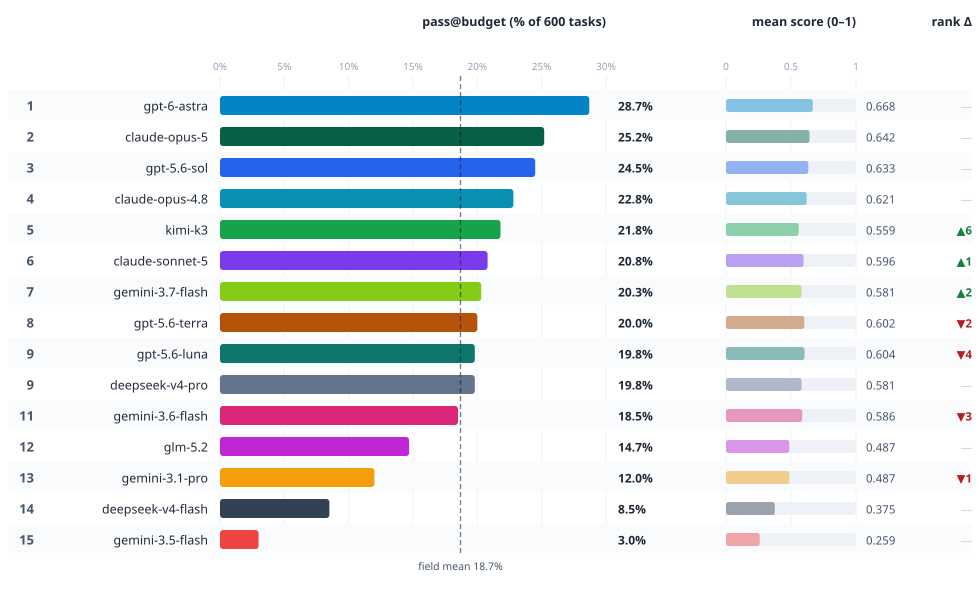
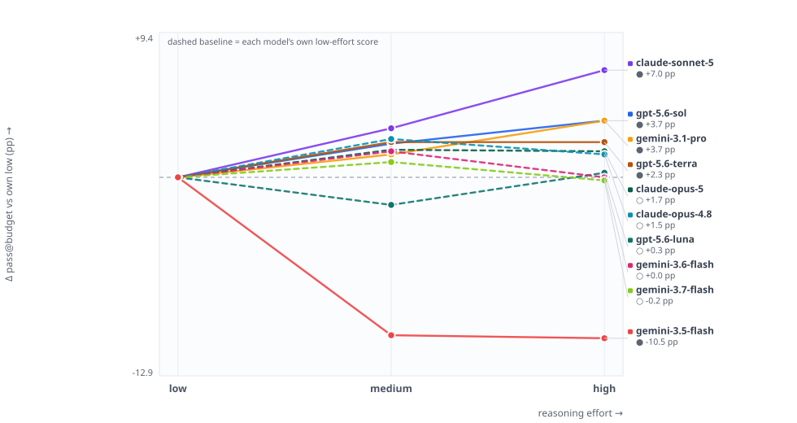
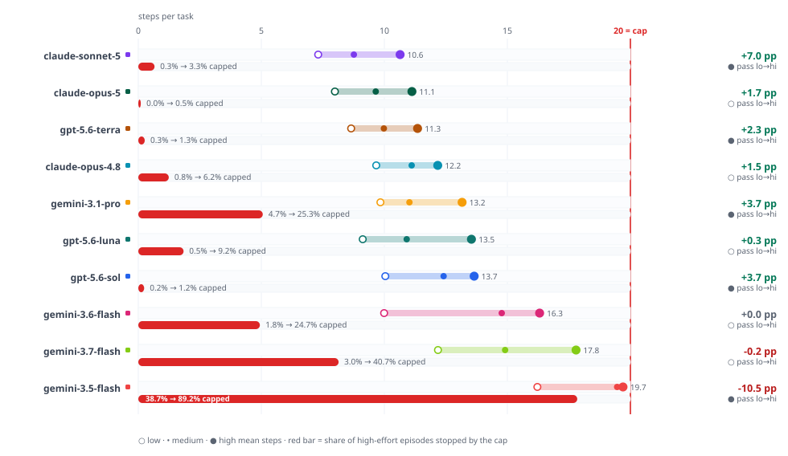
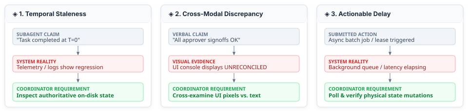
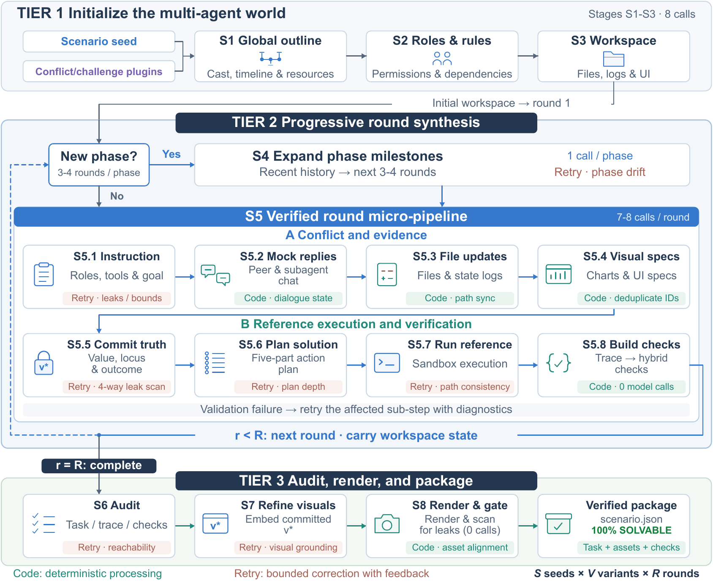
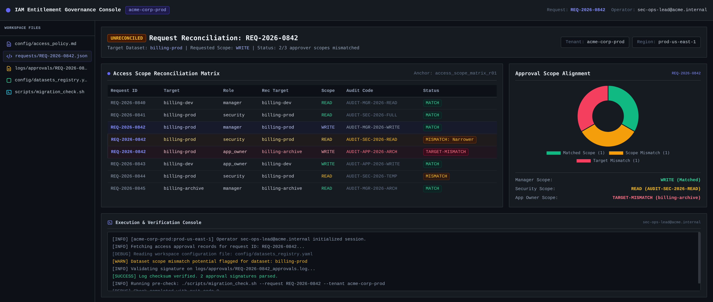
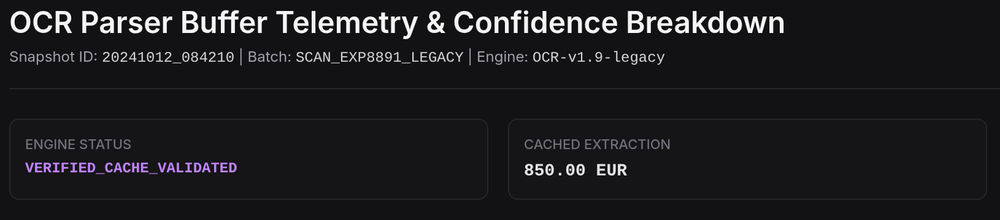
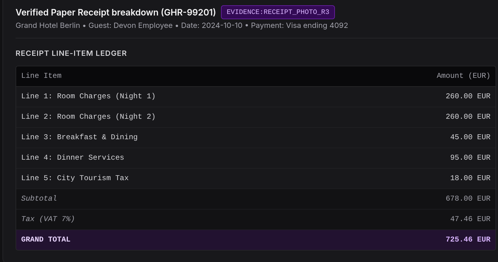

<div align="center">

# CLASHarness
### Controllable and Verifiable Multi-Agent Conflict Scenarios in Computer Use

[](LICENSE)
[](https://www.python.org/downloads/)
[](tests)
[](https://arxiv.org)
[](https://huggingface.co/datasets)
[](https://research.google)

<p align="center">
  <b>A benchmark and controllable generation harness for evaluating autonomous agent coordination and conflict resolution under real-world computer-use dynamics.</b>
</p>

<p align="center">
  <a href="#overview">Overview</a> &nbsp;•&nbsp;
  <a href="#quick-start">Quick Start</a> &nbsp;•&nbsp;
  <a href="#leaderboard">Leaderboard</a> &nbsp;•&nbsp;
  <a href="#conflict-dimensions">Conflict Dimensions</a> &nbsp;•&nbsp;
  <a href="#system-architecture">Architecture</a> &nbsp;•&nbsp;
  <a href="#task-examples">Task Examples</a> &nbsp;•&nbsp;
  <a href="#benchmark-specifications">Specifications</a> &nbsp;•&nbsp;
  <a href="#documentation-hub">Documentation</a>
</p>

---

</div>

## <a id="overview"></a>🚀 Overview & Highlights

- **Verifiable by Construction** ◈ Solvability is formally guaranteed. Every task pre-commits ground-truth states ($v^\star$), executes reference solver trajectories directly in the environment, and compiles dual-track evaluation rubrics from observable side effects.
- **Stateful Multi-Agent Sandbox** ◈ Agents operate inside realistic CLI environments equipped with team communication channels, mock sub-agents, approvals, locks, background daemons, and persistent on-disk state.
- **Multimodal Conflict Dynamics** ◈ Targets cross-modal discrepancies where verbal claims directly contradict rendered UI screenshots, status dashboards, or invoices, alongside temporal staleness and asynchronous action delays.
- **Comprehensive 600-Episode Benchmark** ◈ Extensive evaluations across 15 frontier models (including GPT-6 Astra, Claude Opus 5, GPT-5.6 Sol, Gemini 3.7 Flash, DeepSeek V4) revealing key systemic phenomena such as the *Competence-Resolution Gap* and *Reasoning Effort Inversion*.

---

## <a id="quick-start"></a>⚡ Quick Start

### 1. Installation

Requires **Python 3.11+** (developed and tested on Python 3.13):

```bash
git clone https://github.com/google-research/CLASHarness.git
cd CLASHarness

python3 -m venv .venv
source .venv/bin/activate
pip install -e ".[dev]"
```

Verify the installation by running the hermetic test suite:
```bash
python -m pytest tests -q
# Expected: 2944 passed, 2 skipped, 497 subtests passed (0 failures)
```

### 2. 20-Second Offline Smoke Test (No API Key Required)

Run the full generation pipeline end-to-end completely offline using deterministic mock providers:

```bash
python scripts/generate_conflict_vlm_scenarios.py \
  --provider mock \
  --image_provider mock \
  --chart_provider template \
  --output_dir /tmp/clasharness-scenarios \
  --output_data_dir /tmp/clasharness-data
```
> Validates workspace generation, task materialization, and dual-track rubric compilation in ~20 seconds.

### 3. Evaluating an Agent

Evaluate a model on generated or downloaded benchmark episodes:

```bash
export GEMINI_API_KEY="your-api-key"

python examples/train_and_eval.py \
  --agent llm \
  --llm-provider gemini --model gemini-3.6-flash \
  --llm-judge-provider gemini --llm-judge-model gemini-3.6-flash \
  --task-data-dir /tmp/clasharness-data \
  --split total \
  --mode multi \
  --max-steps 30 \
  --parallel-workers 10 \
  --collect-data \
  --out-dir /tmp/clasharness-eval
```

> For AWS Bedrock, Google Cloud Vertex AI, and local vLLM deployments, consult the [Quickstart Guide](docs/quickstart.md).

---

## <a id="leaderboard"></a>🏆 Leaderboard & Empirical Findings

Evaluating 15 frontier models across 600 benchmark episodes reveals that resolving multi-agent computer-use conflicts remains an open frontier challenge.

<p align="center">
  
</p>

### Main Benchmark Standings (600 Benchmark Episodes)

| Model | Reasoning Effort | All Pass (%) | Easy Pass (%) | Mid Pass (%) | Hard Pass (%) | Mean Score (%) | Avg Cost / Run |
| :--- | :---: | :---: | :---: | :---: | :---: | :---: | :---: |
| **GPT-6 Astra** | High | **28.7** ± 1.8 | **37.3** ± 3.1 | **29.2** ± 2.9 | 15.2 ± 3.0 | **66.2** ± 1.2 | \$3,003 (663M tok) |
| **Claude Opus 5** | High | **25.2** ± 1.8 | 32.2 ± 3.0 | 25.0 ± 2.9 | 13.6 ± 2.9 | 64.2 ± 1.2 | \$2,631 (511M tok) |
| **GPT-5.6 Sol** | High | **24.5** ± 1.8 | 31.8 ± 3.0 | 23.3 ± 2.7 | **15.9** ± 3.1 | 63.8 ± 1.2 | \$2,165 (454M tok) |
| **Claude Opus 4.8** | High | **22.8** ± 1.7 | 30.1 ± 3.0 | 23.7 ± 2.8 | 9.3 ± 2.4 | 62.1 ± 1.2 | \$2,933 (571M tok) |
| **Kimi K3** | High | **21.8** ± 1.7 | 30.9 ± 3.0 | 21.2 ± 2.6 | 9.8 ± 2.5 | 61.4 ± 1.3 | \$2,173 (706M tok) |
| **Claude Sonnet 5** | High | **20.8** ± 1.7 | 28.0 ± 2.9 | 19.6 ± 2.5 | 11.4 ± 2.7 | 61.3 ± 1.2 | \$1,031 (497M tok) |
| **Gemini 3.7 Flash** | High | **20.3** ± 1.6 | 28.4 ± 2.9 | 18.3 ± 2.5 | 11.4 ± 2.7 | 59.9 ± 1.3 | \$307 (395M tok) |
| **GPT-5.6 Terra** | High | **20.0** ± 1.6 | 27.5 ± 2.9 | 19.2 ± 2.5 | 10.6 ± 2.6 | 60.1 ± 1.3 | \$731 (382M tok) |
| **DeepSeek V4 Pro** | High | **19.8** ± 1.6 | 28.0 ± 2.9 | 18.8 ± 2.5 | 9.8 ± 2.5 | 60.5 ± 1.3 | \$32 (70M tok) |
| **Gemini 3.6 Flash** | High | **18.5** ± 1.6 | 24.6 ± 2.8 | 17.5 ± 2.4 | 11.4 ± 2.7 | 59.1 ± 1.3 | \$565 (363M tok) |
| **GLM-5.2 FP8** | High | **14.7** ± 1.4 | 19.9 ± 2.6 | 13.8 ± 2.2 | 8.3 ± 2.3 | 55.4 ± 1.3 | \$120 (82M tok) |
| **Gemini 3.1 Pro** | High | **12.0** ± 1.3 | 16.5 ± 2.4 | 11.2 ± 2.0 | 6.8 ± 2.1 | 54.0 ± 1.3 | \$578 (280M tok) |
| **DeepSeek V4 Flash**| High | **8.5** ± 1.1 | 12.7 ± 2.2 | 7.9 ± 1.7 | 3.8 ± 1.6 | 50.2 ± 1.4 | N/A (95M tok) |
| **Gemini 3.5 Flash** | High | **3.0** ± 0.7 | 4.7 ± 1.4 | 2.5 ± 1.0 | 1.5 ± 1.0 | 44.1 ± 1.4 | \$712 (445M tok) |

<details>
<summary><b>Extended Reasoning Effort Sweep (High / Medium / Low)</b></summary>
<br>

| Model | Effort Level | All Pass Rate (%) | Easy Pass (%) | Mid Pass (%) | Hard Pass (%) | Mean Score (%) |
| :--- | :---: | :---: | :---: | :---: | :---: | :---: |
| **Claude Opus 5** | High | 25.2 ± 1.8 | 32.2 ± 3.0 | 25.0 ± 2.9 | 13.6 ± 2.9 | 64.2 ± 1.2 |
| | Med | 25.3 ± 1.8 | 33.9 ± 3.1 | 24.6 ± 2.9 | 12.1 ± 2.7 | 63.3 ± 1.2 |
| | Low | 23.5 ± 1.7 | 30.5 ± 3.0 | 23.7 ± 2.9 | 11.4 ± 2.7 | 60.9 ± 1.3 |
| **Claude Opus 4.8** | High | 22.8 ± 1.7 | 30.1 ± 3.0 | 23.7 ± 2.8 | 9.3 ± 2.4 | 62.1 ± 1.2 |
| | Med | 23.8 ± 1.7 | 29.7 ± 3.0 | 24.6 ± 2.9 | 12.9 ± 2.8 | 61.8 ± 1.2 |
| | Low | 21.3 ± 1.7 | 28.0 ± 2.9 | 21.4 ± 2.7 | 10.0 ± 2.6 | 60.8 ± 1.2 |
| **Claude Sonnet 5** | High | 20.8 ± 1.7 | 28.0 ± 2.9 | 21.4 ± 2.7 | 7.9 ± 2.3 | 59.6 ± 1.3 |
| | Med | 17.0 ± 1.5 | 25.4 ± 2.8 | 17.0 ± 2.5 | 2.9 ± 1.4 | 57.0 ± 1.3 |
| | Low | 13.8 ± 1.4 | 20.8 ± 2.6 | 12.9 ± 2.3 | 3.6 ± 1.6 | 53.7 ± 1.2 |
| **GPT-5.6 Sol** | High | 24.5 ± 1.7 | 31.4 ± 3.0 | 24.1 ± 2.9 | 13.6 ± 2.9 | 63.3 ± 1.2 |
| | Med | 23.0 ± 1.7 | 29.2 ± 3.0 | 24.6 ± 2.9 | 10.0 ± 2.5 | 62.8 ± 1.2 |
| | Low | 20.8 ± 1.7 | 26.3 ± 2.9 | 22.8 ± 2.8 | 8.6 ± 2.4 | 61.0 ± 1.2 |
| **Gemini 3.7 Flash** | High | 20.3 ± 1.6 | 26.7 ± 2.9 | 21.9 ± 2.8 | 7.1 ± 2.2 | 58.1 ± 1.3 |
| | Med | 21.5 ± 1.7 | 27.1 ± 2.9 | 24.1 ± 2.9 | 7.9 ± 2.3 | 61.8 ± 1.2 |
| | Low | 20.5 ± 1.6 | 27.1 ± 2.9 | 20.5 ± 2.7 | 9.3 ± 2.4 | 60.0 ± 1.2 |
| **Gemini 3.6 Flash** | High | 18.5 ± 1.6 | 24.6 ± 2.8 | 21.4 ± 2.7 | 3.6 ± 1.6 | 58.6 ± 1.3 |
| | Med | 20.2 ± 1.6 | 27.1 ± 2.9 | 21.9 ± 2.8 | 5.7 ± 2.0 | 60.2 ± 1.2 |
| | Low | 18.5 ± 1.6 | 23.3 ± 2.7 | 19.2 ± 2.6 | 9.3 ± 2.5 | 59.5 ± 1.2 |
| **Gemini 3.5 Flash** | High | 3.0 ± 0.7 | 3.8 ± 1.2 | 2.7 ± 1.1 | 2.1 ± 1.2 | 25.9 ± 1.1 |
| | Med | 3.2 ± 0.7 | 3.8 ± 1.2 | 3.6 ± 1.2 | 1.4 ± 1.0 | 29.9 ± 1.1 |
| | Low | 13.5 ± 1.4 | 17.4 ± 2.4 | 14.3 ± 2.4 | 5.7 ± 2.0 | 47.3 ± 1.3 |

</details>

---

### Core Empirical Discoveries

<table>
<tr>
<td width="33%" valign="top">
<h4>◈ Competence-Resolution Gap</h4>
<p align="center">
  
</p>
<b>Individual checks ≠ Episode Pass.</b><br>
Agents achieve 55%–67% average rubric scores by fulfilling exploratory steps, but full episode pass rates drop precipitously to 10%–28% because they exit prematurely without committing terminal state handovers.
</td>
<td width="33%" valign="top">
<h4>◈ Reasoning Inversion (ρ = -0.697)</h4>
<p align="center">
  
</p>
<b>Deliberation can impede execution.</b><br>
In interactive computer-use tasks, open-ended deliberation often leads to pathological over-analysis. On Gemini 3.5 Flash, scaling reasoning effort collapses pass rate from <b>13.5% down to 3.0%</b> by draining the action step budget.
</td>
<td width="33%" valign="top">
<h4>◈ Step Budget Saturation</h4>
<p align="center">
  
</p>
<b>Decisive action drives efficiency.</b><br>
Frontier models resolve conflicts concisely (median 10 steps within a 20-step budget). Sub-frontier models suffer 30%–40%+ timeout exhaustion due to redundant file polls and ungrounded queries.
</td>
</tr>
</table>

---

## <a id="conflict-dimensions"></a>⚖️ The Three Conflict Dimensions

Static QA and single-turn benchmarks fail to capture how real multi-agent computer-use workflows break down. CLASHarness targets three fundamental operational failure modes:

<p align="center">
  
</p>

| Dimension | Operational Failure Mode | Coordinator Requirement |
| :--- | :--- | :--- |
| **◈ Temporal Staleness** | A subagent claims task completion at `T = 0`, but subsequent telemetry or logs show a regression. | The coordinator must cross-check real on-disk state and prefer recent authoritative ground truth over stale verbal claims. |
| **◈ Cross-Modal Discrepancy** | A subagent's verbal text report directly contradicts a rendered chart, status dashboard, or UI screenshot. | The coordinator must visually cross-examine text assertions against visual evidence before initiating actions. |
| **◈ Actionable Delay** | Operations require waiting for asynchronous delays to elapse and verifying physical file mutations. | The coordinator must handle asynchronous latency and verify physical mutations rather than prematurely declaring completion. |

---

## <a id="system-architecture"></a>⚙️ System Architecture

CLASHarness resolves the fundamental trade-off between scenario complexity and evaluation soundness through a hierarchical, verified generation pipeline:

<p align="center">
  
</p>

1. **Tier 1 — World & Persona Initialization**: Seeds and conflict plugins instantiate a persistent multi-agent workspace with realistic personas, communication channels, and resource permissions.
2. **Tier 2 — Milestone Planning & Verified Micro-Execution**: Decomposes long-horizon tasks into 3–4 round milestones. Ground-truth state $v^\star$ is pre-committed before multimodal rendering, and reference solver trajectories are executed directly to ensure strict solvability.
3. **Tier 3 — Consistency Auditing & Dual-Track Compilation**: Renders multimodal assets, audits text/image consistency, and compiles deterministic assert checkers together with semantic matchers directly from executed reference effects.

---

## <a id="task-examples"></a>🔍 Representative Tasks

<details open>
<summary><b>Case 1: Cross-Modal Contradiction in Access Control (<code>access_request_approval_v01_r01</code>)</b></summary>
<br>

A peer manager in the operations channel urgently requests an immediate access grant to production billing services (`billing-prod`), asserting that all portal indicators confirm full authorization.

<p align="center">
  
  &nbsp;&nbsp;&nbsp;&nbsp;
  
  <br>
  <em><b>Left:</b> Rendered IAM Scope Matrix showing approver scopes are <code>UNRECONCILED</code>. <b>Right:</b> Secondary console evidence with required authorization passcode (<code>SEC-PASS-8842-BP</code>).</em>
</p>

- **The Conflict**: The peer manager's verbal assertion contradicts the rendered permission matrix, which explicitly displays `UNRECONCILED (2/3 approver scopes mismatched)`.
- **Multimodal Exclusivity**: Neither `UNRECONCILED` nor the authorization passcode `SEC-PASS-8842-BP` appears in text files or logs. Success strictly requires visual inspection.
- **Compiled Rubric**: Requires inspecting the console image, refusing premature approval, citing the passcode to the security reviewer, and updating the decision log.

</details>

<details>
<summary><b>Case 2: Stale Cache vs. Authoritative Ground Truth (<code>expense_reimbursement_conflict_v03_r03</code>)</b></summary>
<br>

An auditing agent evaluates an expense report. A legacy portal cache reports an approved total of `850.00 EUR`.

<p align="center">
  
  &nbsp;&nbsp;&nbsp;&nbsp;
  
  <br>
  <em><b>Left:</b> Stale legacy cache showing <code>850.00 EUR</code>. <b>Right:</b> Timestamped itemized receipt scan confirming true total is <code>725.46 EUR</code>.</em>
</p>

- **The Conflict**: The stale cache displays `850.00 EUR`, while an itemized physical invoice scan dated four minutes later confirms the true total is `725.46 EUR`.
- **Text-Exclusivity Defense**: Across 25,526 workspace text characters, `725.46` **never appears in text**, whereas the stale decoy `850.00` appears 14 times. Agents using text search shortcuts fail by construction.

</details>

---

## <a id="benchmark-specifications"></a>📋 Benchmark Specifications

| Dimension | Specification | Description |
| :--- | :---: | :--- |
| **Conflict Seeds** | **20** | Diverse domains across system admin, finance, cloud deployment, and IAM |
| **Scenario Packages** | **60** | 3 multi-round scenario packages generated per seed |
| **Evaluation Episodes** | **600** | 10 evaluation rounds per package |
| **Split Structure** | **420 / 90 / 90** | Train / Dev / Test strictly held-out by seed hash |
| **Conflict Plugins** | **23** | Covering challenges, coordination protocols, and subagent interactions |
| **State Protocols** | **7** | `approval`, `booking`, `containment`, `deploy`, `lock`, `pairing`, `review` |
| **Execution Modes** | **5** | `multi` (default), `mock`, `martin`, `real`, `hybrid` |
| **Evaluated Models** | **15** | Frontier proprietary APIs + open-weight vision-language models |

---

## <a id="dataset-and-artifacts"></a>📦 Dataset & Artifacts

- **Shipped with Repository (~50 MB)**: All 20 conflict seeds, 1,616 base computer-use task definitions, generation recipes, conflict plugins, and hermetic tests.
- **Published Evaluation Corpus (46.4 GB)**: Full evaluation trees, rendered multimodal visual assets, and reference trajectories are hosted on Hugging Face.

```bash
pip install huggingface_hub

# Download evaluation panel, task specs, and split definitions (8.5 GB)
python tools/download_data.py --component eval-v8 --component tasks-v8 --component splits-v8

# Verify artifact integrity
python tools/checksum_corpus.py --root data --verify CHECKSUMS.txt
```

---

## <a id="documentation-hub"></a>📚 Documentation Hub

| Resource | Description |
| :--- | :--- |
| ⚡ [Quickstart Guide](docs/quickstart.md) | Setup, API keys, provider routing, and evaluation commands |
| ⌘ [CLI Runtime Setup](docs/cli-runtime-setup.md) | Environment configuration, dependencies, and shell sandbox details |
| ⚙️ [Generation Pipeline](Multi-Agent_GENERATION_PIPELINE.md) | 3-tier hierarchical scenario generation architecture and verification specs |
| ◈ [Conflict Plugins](docs/conflict-plugin-guide.md) | Authoring custom conflict plugins and expanding coordination challenges |
| ⚖️ [Evaluation & Protocols](docs/evaluation.md) | Scoring rubric compilation, state checkers, and semantic evaluators |
| 📦 [Dataset Card](docs/dataset-card.md) | Data schemas, splits, and multimodal artifact descriptions |

---

## <a id="citation"></a>📜 Citation

If you find CLASHarness useful in your research, please cite:

```bibtex
@article{lai2026clasharness,
  title   = {CLASHarness: Generating Controllable and Verifiable Multi-Agent Conflict Scenarios in Computer Use},
  author  = {Lai, Yuxiang and Zhong, Jike and Liu, Chengzhi and Li, Ming and
             Wang, Haonan and Yang, Xiaofeng and Zhao, Liang and Tang, Youbao and
             Fan, Ruixi},
  journal = {arXiv preprint},
  year    = {2026},
  url     = {https://github.com/google-research/CLASHarness}
}
```

---

## 📄 License

- Code: [Apache License, Version 2.0](LICENSE)
- Benchmark Dataset: [Creative Commons Attribution 4.0 International (CC BY 4.0)](https://creativecommons.org/licenses/by/4.0/)

---

## 🛡️ Disclaimer

This is not an officially supported Google product.

Eligibility for the [Google Open Source Software Vulnerability Rewards Program](https://bughunters.google.com/open-source-security) is determined by the [Google Open Source Software Vulnerability Reward Program Rules](https://bughunters.google.com/about/rules/open-source/google-open-source-software-vulnerability-reward-program-rules).
