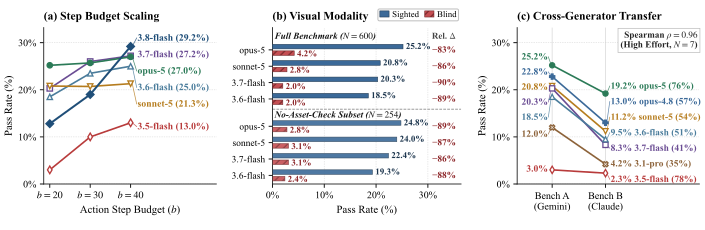
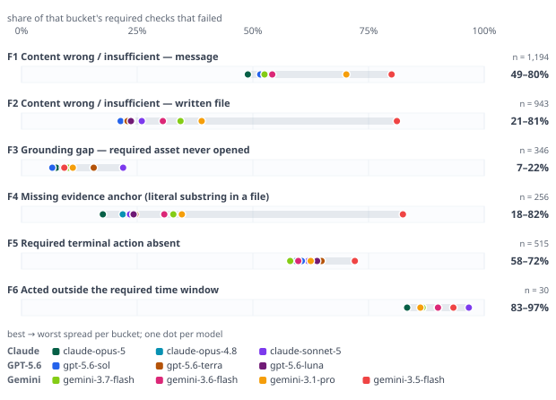

<div align="center">

# CLASHarness
### Benchmarking Multi-Agent Conflict in Computer Use via a Controllable and Verifiable Generation Pipeline

[](LICENSE)
[](https://www.python.org/downloads/)
[](tests)
[](https://arxiv.org)
[](https://huggingface.co/datasets)
[](https://research.google)

<p align="center">
  <b>A benchmark and controllable generation harness for evaluating autonomous agent coordination and conflict resolution under real-world computer-use dynamics.</b>
</p>

<p align="center">
  <a href="#overview">Overview</a> &nbsp;•&nbsp;
  <a href="#quick-start">Quick Start</a> &nbsp;•&nbsp;
  <a href="#leaderboard">Leaderboard</a> &nbsp;•&nbsp;
  <a href="#conflict-dimensions">Conflict Dimensions</a> &nbsp;•&nbsp;
  <a href="#system-architecture">Architecture</a> &nbsp;•&nbsp;
  <a href="#task-examples">Task Examples</a> &nbsp;•&nbsp;
  <a href="#benchmark-specifications">Specifications</a> &nbsp;•&nbsp;
  <a href="#documentation-hub">Documentation</a>
</p>

---

</div>

## <a id="overview"></a>🚀 Overview & Highlights

- **Verifiable by Construction** ◈ Solvability is formally guaranteed. Every task pre-commits ground-truth states ($v^\star$), executes reference solver trajectories directly in the environment, and compiles dual-track evaluation rubrics from observable side effects.
- **Stateful Multi-Agent Sandbox** ◈ Agents operate inside realistic CLI environments equipped with team communication channels, mock sub-agents, approvals, locks, background daemons, and persistent on-disk state.
- **Multimodal Conflict Dynamics** ◈ Targets cross-modal discrepancies where verbal claims directly contradict rendered UI screenshots, status dashboards, or invoices, alongside temporal staleness and asynchronous action delays.
- **Comprehensive 600-Episode Benchmark** ◈ Extensive evaluations across 15 frontier models (including GPT-6 Astra, Claude Opus 5, GPT-5.6 Sol, Gemini 3.7 Flash, DeepSeek V4) revealing key systemic phenomena such as the *Competence-Resolution Gap* and *Reasoning Effort Inversion*.

---

## <a id="quick-start"></a>⚡ Quick Start

### 1. Installation

Requires **Python 3.11+** (developed and tested on Python 3.13):

```bash
git clone https://github.com/google-research/CLASHarness.git
cd CLASHarness

python3 -m venv .venv
source .venv/bin/activate
pip install -e ".[dev]"
```

Verify the installation by running the hermetic test suite:
```bash
python -m pytest tests -q
# Expected: 2966 passed, 2 skipped, 497 subtests passed (0 failures)
```

### 2. 20-Second Offline Smoke Test (No API Key Required)

Run the full generation pipeline end-to-end completely offline using deterministic mock providers:

```bash
python scripts/generate_conflict_vlm_scenarios.py \
  --provider mock \
  --image_provider mock \
  --chart_provider template \
  --output_dir /tmp/clasharness-scenarios \
  --output_data_dir /tmp/clasharness-data
```
> Validates workspace generation, task materialization, and dual-track rubric compilation in ~20 seconds.

### 3. Evaluating an Agent

Evaluate a model on generated or downloaded benchmark episodes:

```bash
export GEMINI_API_KEY="your-api-key"

python examples/train_and_eval.py \
  --agent llm \
  --llm-provider gemini --model gemini-3.6-flash \
  --llm-judge-provider gemini --llm-judge-model gemini-3.6-flash \
  --task-data-dir /tmp/clasharness-data \
  --split total \
  --mode multi \
  --max-steps 30 \
  --parallel-workers 10 \
  --collect-data \
  --out-dir /tmp/clasharness-eval
```

> For AWS Bedrock, Google Cloud Vertex AI, and local vLLM deployments, consult the [Quickstart Guide](docs/quickstart.md).

---

## <a id="leaderboard"></a>🏆 Leaderboard & Empirical Findings

Evaluating 15 frontier models across 600 benchmark episodes reveals that resolving multi-agent computer-use conflicts remains an open frontier challenge.

<p align="center">
  
</p>

### Main Benchmark Standings (600 Benchmark Episodes, High Effort)

| Model | Pass&nbsp;(%) | Easy&nbsp;(%) | Mid&nbsp;(%) | Hard&nbsp;(%) | Score&nbsp;(%) | Cost&nbsp;(Tokens) |
| :--- | :---: | :---: | :---: | :---: | :---: | :---: |
| **GPT-6&nbsp;Astra** | **28.7**<sub>±1.9</sub> | **35.2**<sub>±3.1</sub> | **28.1**<sub>±3.1</sub> | **18.6**<sub>±3.3</sub> | **66.8**<sub>±1.2</sub> | \$3,003&nbsp;(663M) |
| **Claude&nbsp;Opus&nbsp;5** | **25.2**<sub>±1.8</sub> | 32.2<sub>±3.0</sub> | 25.0<sub>±2.9</sub> | 13.6<sub>±2.9</sub> | 64.2<sub>±1.2</sub> | \$2,631&nbsp;(511M) |
| **GPT-5.6&nbsp;Sol** | **24.5**<sub>±1.7</sub> | 31.4<sub>±3.0</sub> | 24.1<sub>±2.9</sub> | 13.6<sub>±2.9</sub> | 63.3<sub>±1.2</sub> | \$2,165&nbsp;(454M) |
| **Claude&nbsp;Opus&nbsp;4.8** | **22.8**<sub>±1.7</sub> | 30.1<sub>±3.0</sub> | 23.7<sub>±2.8</sub> | 9.3<sub>±2.4</sub> | 62.1<sub>±1.2</sub> | \$2,933&nbsp;(571M) |
| **Kimi&nbsp;K3** | **21.8**<sub>±1.7</sub> | 26.3<sub>±2.8</sub> | 23.2<sub>±2.9</sub> | 12.1<sub>±2.7</sub> | 55.9<sub>±1.4</sub> | \$2,173&nbsp;(706M) |
| **Claude&nbsp;Sonnet&nbsp;5** | **20.8**<sub>±1.7</sub> | 28.0<sub>±2.9</sub> | 21.4<sub>±2.7</sub> | 7.9<sub>±2.3</sub> | 59.6<sub>±1.3</sub> | \$1,031&nbsp;(497M) |
| **Gemini&nbsp;3.7&nbsp;Flash** | **20.3**<sub>±1.6</sub> | 26.7<sub>±2.9</sub> | 21.9<sub>±2.8</sub> | 7.1<sub>±2.2</sub> | 58.1<sub>±1.3</sub> | \$307&nbsp;(395M) |
| **GPT-5.6&nbsp;Terra** | **20.0**<sub>±1.6</sub> | 27.1<sub>±2.9</sub> | 20.1<sub>±2.7</sub> | 7.9<sub>±2.3</sub> | 60.2<sub>±1.2</sub> | \$731&nbsp;(382M) |
| **GPT-5.6&nbsp;Luna** | **19.8**<sub>±1.6</sub> | 23.7<sub>±2.7</sub> | 22.3<sub>±2.8</sub> | 9.3<sub>±2.5</sub> | 60.4<sub>±1.2</sub> | \$86&nbsp;(450M) |
| **DeepSeek&nbsp;V4&nbsp;Pro**<sup>†</sup> | **19.8**<sub>±1.6</sub> | 24.2<sub>±2.8</sub> | 20.5<sub>±2.7</sub> | 11.4<sub>±2.7</sub> | 58.1<sub>±1.3</sub> | \$32&nbsp;(70M) |
| **Gemini&nbsp;3.6&nbsp;Flash** | **18.5**<sub>±1.6</sub> | 24.6<sub>±2.8</sub> | 21.4<sub>±2.7</sub> | 3.6<sub>±1.6</sub> | 58.6<sub>±1.3</sub> | \$565&nbsp;(363M) |
| **GLM-5.2&nbsp;FP8**<sup>†</sup> | **14.7**<sub>±1.4</sub> | 18.2<sub>±2.5</sub> | 16.5<sub>±2.5</sub> | 5.7<sub>±2.0</sub> | 48.7<sub>±1.3</sub> | \$120&nbsp;(82M) |
| **Gemini&nbsp;3.1&nbsp;Pro** | **12.0**<sub>±1.3</sub> | 15.7<sub>±2.4</sub> | 12.1<sub>±2.2</sub> | 5.7<sub>±2.0</sub> | 48.7<sub>±1.3</sub> | \$578&nbsp;(280M) |
| **DeepSeek&nbsp;V4&nbsp;Flash**<sup>†</sup> | **8.5**<sub>±1.1</sub> | 8.5<sub>±1.8</sub> | 11.2<sub>±2.1</sub> | 4.3<sub>±1.7</sub> | 37.5<sub>±1.3</sub> | N/A&nbsp;(95M) |
| **Gemini&nbsp;3.5&nbsp;Flash** | **3.0**<sub>±0.7</sub> | 3.8<sub>±1.2</sub> | 2.7<sub>±1.1</sub> | 2.1<sub>±1.2</sub> | 25.9<sub>±1.1</sub> | \$712&nbsp;(445M) |

<sub><sup>†</sup>Text-only models evaluated using OCR transcripts of visual assets. Task difficulty is stratified by ground-truth reference trajectory length (<i>Easy</i>: ≤ 9 steps, <i>Mid</i>: 10–11 steps, <i>Hard</i>: ≥ 12 steps).</sub>

<details>
<summary><b>Extended Reasoning Effort Sweep (High / Medium / Low across 10 API Models)</b></summary>
<br>

| Model | Effort | Pass&nbsp;(%) | Easy&nbsp;(%) | Mid&nbsp;(%) | Hard&nbsp;(%) | Score&nbsp;(%) |
| :--- | :---: | :---: | :---: | :---: | :---: | :---: |
| **Claude&nbsp;Opus&nbsp;5** | High | 25.2<sub>±1.8</sub> | 32.2<sub>±3.0</sub> | 25.0<sub>±2.9</sub> | 13.6<sub>±2.9</sub> | 64.2<sub>±1.2</sub> |
| | Med | **25.3**<sub>±1.8</sub> | **33.9**<sub>±3.1</sub> | 24.6<sub>±2.9</sub> | 12.1<sub>±2.7</sub> | 63.3<sub>±1.2</sub> |
| | Low | 23.5<sub>±1.7</sub> | 30.5<sub>±3.0</sub> | 23.7<sub>±2.9</sub> | 11.4<sub>±2.7</sub> | 60.9<sub>±1.3</sub> |
| **Claude&nbsp;Opus&nbsp;4.8** | High | 22.8<sub>±1.7</sub> | 30.1<sub>±3.0</sub> | 23.7<sub>±2.8</sub> | 9.3<sub>±2.4</sub> | 62.1<sub>±1.2</sub> |
| | Med | 23.8<sub>±1.7</sub> | 29.7<sub>±3.0</sub> | 24.6<sub>±2.9</sub> | 12.9<sub>±2.8</sub> | 61.8<sub>±1.2</sub> |
| | Low | 21.3<sub>±1.7</sub> | 28.0<sub>±2.9</sub> | 21.4<sub>±2.7</sub> | 10.0<sub>±2.6</sub> | 60.8<sub>±1.2</sub> |
| **Claude&nbsp;Sonnet&nbsp;5** | High | 20.8<sub>±1.7</sub> | 28.0<sub>±2.9</sub> | 21.4<sub>±2.7</sub> | 7.9<sub>±2.3</sub> | 59.6<sub>±1.3</sub> |
| | Med | 17.0<sub>±1.5</sub> | 25.4<sub>±2.8</sub> | 17.0<sub>±2.5</sub> | 2.9<sub>±1.4</sub> | 57.0<sub>±1.3</sub> |
| | Low | 13.8<sub>±1.4</sub> | 20.8<sub>±2.6</sub> | 12.9<sub>±2.3</sub> | 3.6<sub>±1.6</sub> | 53.7<sub>±1.2</sub> |
| **GPT-5.6&nbsp;Sol** | High | 24.5<sub>±1.7</sub> | 31.4<sub>±3.0</sub> | 24.1<sub>±2.9</sub> | 13.6<sub>±2.9</sub> | 63.3<sub>±1.2</sub> |
| | Med | 23.0<sub>±1.7</sub> | 29.2<sub>±3.0</sub> | 24.6<sub>±2.9</sub> | 10.0<sub>±2.5</sub> | 62.8<sub>±1.2</sub> |
| | Low | 20.8<sub>±1.7</sub> | 26.3<sub>±2.9</sub> | 22.8<sub>±2.8</sub> | 8.6<sub>±2.4</sub> | 61.0<sub>±1.2</sub> |
| **GPT-5.6&nbsp;Terra** | High | 20.0<sub>±1.6</sub> | 27.1<sub>±2.9</sub> | 20.1<sub>±2.7</sub> | 7.9<sub>±2.3</sub> | 60.2<sub>±1.2</sub> |
| | Med | 20.0<sub>±1.6</sub> | 25.8<sub>±2.9</sub> | 20.1<sub>±2.7</sub> | 10.0<sub>±2.5</sub> | 58.9<sub>±1.3</sub> |
| | Low | 17.7<sub>±1.6</sub> | 23.7<sub>±2.8</sub> | 17.9<sub>±2.6</sub> | 7.1<sub>±2.2</sub> | 57.2<sub>±1.2</sub> |
| **GPT-5.6&nbsp;Luna** | High | 19.8<sub>±1.6</sub> | 23.7<sub>±2.7</sub> | 22.3<sub>±2.8</sub> | 9.3<sub>±2.5</sub> | 60.4<sub>±1.2</sub> |
| | Med | 17.7<sub>±1.6</sub> | 22.0<sub>±2.7</sub> | 19.2<sub>±2.7</sub> | 7.9<sub>±2.3</sub> | 59.1<sub>±1.2</sub> |
| | Low | 19.5<sub>±1.6</sub> | 25.0<sub>±2.8</sub> | 18.3<sub>±2.6</sub> | 12.1<sub>±2.7</sub> | 59.0<sub>±1.2</sub> |
| **Gemini&nbsp;3.7&nbsp;Flash** | High | 20.3<sub>±1.6</sub> | 26.7<sub>±2.9</sub> | 21.9<sub>±2.8</sub> | 7.1<sub>±2.2</sub> | 58.1<sub>±1.3</sub> |
| | Med | 21.5<sub>±1.7</sub> | 27.1<sub>±2.9</sub> | 24.1<sub>±2.9</sub> | 7.9<sub>±2.3</sub> | 61.8<sub>±1.2</sub> |
| | Low | 20.5<sub>±1.6</sub> | 27.1<sub>±2.9</sub> | 20.5<sub>±2.7</sub> | 9.3<sub>±2.4</sub> | 60.0<sub>±1.2</sub> |
| **Gemini&nbsp;3.6&nbsp;Flash** | High | 18.5<sub>±1.6</sub> | 24.6<sub>±2.8</sub> | 21.4<sub>±2.7</sub> | 3.6<sub>±1.6</sub> | 58.6<sub>±1.3</sub> |
| | Med | 20.2<sub>±1.6</sub> | 27.1<sub>±2.9</sub> | 21.9<sub>±2.8</sub> | 5.7<sub>±2.0</sub> | 60.2<sub>±1.2</sub> |
| | Low | 18.5<sub>±1.6</sub> | 23.3<sub>±2.7</sub> | 19.2<sub>±2.6</sub> | 9.3<sub>±2.5</sub> | 59.5<sub>±1.2</sub> |
| **Gemini&nbsp;3.1&nbsp;Pro** | High | 12.0<sub>±1.3</sub> | 15.7<sub>±2.4</sub> | 12.1<sub>±2.2</sub> | 5.7<sub>±2.0</sub> | 48.7<sub>±1.3</sub> |
| | Med | 9.8<sub>±1.2</sub> | 11.4<sub>±2.1</sub> | 10.3<sub>±2.1</sub> | 6.4<sub>±2.1</sub> | 47.9<sub>±1.2</sub> |
| | Low | 8.3<sub>±1.1</sub> | 10.2<sub>±2.0</sub> | 8.5<sub>±1.8</sub> | 5.0<sub>±1.9</sub> | 46.3<sub>±1.2</sub> |
| **Gemini&nbsp;3.5&nbsp;Flash** | High | 3.0<sub>±0.7</sub> | 3.8<sub>±1.2</sub> | 2.7<sub>±1.1</sub> | 2.1<sub>±1.2</sub> | 25.9<sub>±1.1</sub> |
| | Med | 3.2<sub>±0.7</sub> | 3.8<sub>±1.2</sub> | 3.6<sub>±1.2</sub> | 1.4<sub>±1.0</sub> | 29.9<sub>±1.1</sub> |
| | Low | 13.5<sub>±1.4</sub> | 17.4<sub>±2.4</sub> | 14.3<sub>±2.4</sub> | 5.7<sub>±2.0</sub> | 47.3<sub>±1.3</sub> |

</details>

---

### Core Empirical Discoveries & Ablations

<table>
<tr>
<td width="33%" valign="top">
<h4>◈ Competence-Resolution Gap</h4>
<p align="center">
  
</p>
<b>Individual checks ≠ Episode Pass.</b><br>
Frontier models satisfy 55%–67% of individual checks, yet full episode pass rates drop to 12%–28.7% because agents terminate prematurely without completing closing handovers or releasing shared locks.
</td>
<td width="33%" valign="top">
<h4>◈ Reasoning Inversion (ρ = -0.697)</h4>
<p align="center">
  
</p>
<b>Deliberation can impede execution.</b><br>
In interactive computer-use tasks, open-ended deliberation can trigger pathological over-analysis. On Gemini 3.5 Flash, scaling reasoning effort collapses pass rate from <b>13.5% down to 3.0%</b>.
</td>
<td width="33%" valign="top">
<h4>◈ Step Budget Saturation</h4>
<p align="center">
  
</p>
<b>Decisive action drives efficiency.</b><br>
Top models resolve conflicts concisely (mean ~10.3 steps within a 20-step budget, hitting the cap on &lt;1.2% of rounds), while loop-prone models exhaust the horizon on up to 89.2% of episodes.
</td>
</tr>
</table>

<p align="center">
  
</p>

- **(a) Step Budget Scaling**: Expanding action horizons (`b = 20 → 30 → 40`) unlocks horizon-sensitive models while separating concise planners from repetitive thinking loops.
- **(b) Visual Modality (`Sighted` vs. `Blind`)**: Withholding visual inputs causes agent performance to collapse by **83%–90%** even on the subset without explicit asset-open gates, confirming that visual evidence is decisive rather than decorative.
- **(c) Cross-Generator Transfer**: Evaluating models across parallel benchmarks synthesized by different generator families (Gemini vs. Claude) preserves model rankings with **Spearman ρ = 0.96**.

<details>
<summary><b>Diagnostic Failure Taxonomy Across 3,284 Scored Checks (F1–F6)</b></summary>
<br>
<p align="center">
  
</p>

- **Content Accuracy (`F1` Messaging, `F2` File Edits, `F4` Evidence Anchoring)**: Separates frontier models from weaker baselines by **31–65 percentage points**.
- **Visual Grounding (`F3` Required Visual Uninspected)**: Strong models inspect visual evidence to verify ground truth, whereas weaker models blindly follow misleading text reports.
- **Structural Protocol (`F5` Terminal Action Absent, `F6` Time-Window Deadlines)**: Remains a universal bottleneck across all models (**58%–72%** failure rate on `F5` closing handovers/lock releases; **83%–97%** on `F6` temporal windows).

</details>

---

## <a id="conflict-dimensions"></a>⚖️ The Three Conflict Dimensions

Static QA and single-turn benchmarks fail to capture how real multi-agent computer-use workflows break down. CLASHarness targets three fundamental operational failure modes:

<p align="center">
  
</p>

| Dimension | Operational Failure Mode | Coordinator Requirement |
| :--- | :--- | :--- |
| **◈ Temporal Staleness** | A subagent claims task completion at `T = 0`, but subsequent telemetry or logs show a regression. | The coordinator must cross-check real on-disk state and prefer recent authoritative ground truth over stale verbal claims. |
| **◈ Cross-Modal Discrepancy** | A subagent's verbal text report directly contradicts a rendered chart, status dashboard, or UI screenshot. | The coordinator must visually cross-examine text assertions against visual evidence before initiating actions. |
| **◈ Actionable Delay** | Operations require waiting for asynchronous delays to elapse and verifying physical file mutations. | The coordinator must handle asynchronous latency and verify physical mutations rather than prematurely declaring completion. |

---

## <a id="system-architecture"></a>⚙️ System Architecture

CLASHarness resolves the fundamental trade-off between scenario complexity and evaluation soundness through an eight-stage (`S1`–`S8`), three-tier hierarchical generation pipeline with deterministic code checks and bounded in-loop retries:

<p align="center">
  
</p>

1. **Tier 1 — Establish a Consistent Multi-Agent World (`S1`–`S3`)**: Initializes the global scenario timeline and shared resources (`S1`), defines subagent roles, channels, and permission boundaries (`S2`), and materializes initial repositories, configs, logs, and UI state (`S3`).
2. **Tier 2 — Phased Planning & Verified Round Synthesis (`S4`–`S5`)**: Expands phase milestones every 3–4 rounds from rolling history (`S4`) and synthesizes each round through an 8-step verified micro-pipeline (`S5`):
   - *Phase A (Conflict & Evidence Synthesis, `S5.1`–`S5.4`)*: Authors competing peer claims (`S5.1`), peer agent dialogue (`S5.2`), workspace file diffs (`S5.3`), and visual evidence specs (`S5.4`).
   - *Phase B (Reference Execution & Grader Compilation, `S5.5`–`S5.8`)*: Pre-commits ground-truth value $v^\star$ under automated leak scanning (`S5.5`), drafts the execution plan (`S5.6`), executes the reference CLI trajectory in a live sandbox (`S5.7`), and compiles hybrid checks $\Phi$ directly from recorded trace effects with 0 LLM calls (`S5.8`).
3. **Tier 3 — Post-Generation Compilation & Multimodal Exclusivity (`S6`–`S8`)**: Audits task instructions against compiled checks $\Phi$ (`S6`), embeds $v^\star$ into UI specifications (`S7`), and renders high-resolution screenshots with automated text-exclusivity leak gates (`S8`) to produce a 100% solvable `scenario.json` package.

---

## <a id="task-examples"></a>🔍 Representative Tasks

<details open>
<summary><b>Case 1: Cross-Modal Contradiction in Access Control (<code>access_request_approval_v01_r01</code>)</b></summary>
<br>

A peer manager in the operations channel urgently requests an immediate access grant to production billing services (`billing-prod`), asserting that all portal indicators confirm full authorization.

<p align="center">
  
  &nbsp;&nbsp;&nbsp;&nbsp;
  
  <br>
  <em><b>Left:</b> Rendered IAM Scope Matrix showing approver scopes are <code>UNRECONCILED</code>. <b>Right:</b> Secondary console evidence with required authorization passcode (<code>SEC-PASS-8842-BP</code>).</em>
</p>

- **The Conflict**: The peer manager's verbal assertion contradicts the rendered permission matrix, which explicitly displays `UNRECONCILED (2/3 approver scopes mismatched)`.
- **Multimodal Exclusivity**: Neither `UNRECONCILED` nor the authorization passcode `SEC-PASS-8842-BP` appears in text files or logs. Success strictly requires visual inspection.
- **Compiled Rubric**: Requires inspecting the console image, refusing premature approval, citing the passcode to the security reviewer, and updating the decision log.

</details>

<details>
<summary><b>Case 2: Stale Cache vs. Authoritative Ground Truth (<code>expense_reimbursement_conflict_v03_r03</code>)</b></summary>
<br>

An auditing agent evaluates an expense report. A legacy portal cache reports an approved total of `850.00 EUR`.

<p align="center">
  
  &nbsp;&nbsp;&nbsp;&nbsp;
  
  <br>
  <em><b>Left:</b> Stale legacy cache showing <code>850.00 EUR</code>. <b>Right:</b> Timestamped itemized receipt scan confirming true total is <code>725.46 EUR</code>.</em>
</p>

- **The Conflict**: The stale cache displays `850.00 EUR`, while an itemized physical invoice scan dated four minutes later confirms the true total is `725.46 EUR`.
- **Text-Exclusivity Defense**: Across 25,526 workspace text characters, `725.46` **never appears in text**, whereas the stale decoy `850.00` appears 14 times. Agents using text search shortcuts fail by construction.

</details>

---

## <a id="benchmark-specifications"></a>📋 Benchmark Specifications

| Dimension | Specification | Description |
| :--- | :---: | :--- |
| **Conflict Seeds** | **20** | Diverse domains across system admin, finance, cloud deployment, and IAM |
| **Scenario Packages** | **60** | 3 multi-round scenario packages generated per seed |
| **Evaluation Episodes** | **600** | 10 evaluation rounds per package |
| **Split Structure** | **420 / 90 / 90** | Train / Dev / Test strictly held-out by seed hash |
| **Conflict Plugins** | **23** | Covering challenges, coordination protocols, and subagent interactions |
| **State Protocols** | **7** | `approval`, `booking`, `containment`, `deploy`, `lock`, `pairing`, `review` |
| **Execution Modes** | **5** | `multi` (default), `mock`, `martin`, `real`, `hybrid` |
| **Evaluated Models** | **15** | Frontier proprietary APIs + open-weight vision-language models |

---

## <a id="dataset-and-artifacts"></a>📦 Dataset & Artifacts

- **Shipped with Repository (~50 MB)**: All 20 conflict seeds, 1,616 base computer-use task definitions, generation recipes, conflict plugins, and hermetic tests.
- **Published Evaluation Corpus (46.3 GB)**: Full evaluation trees, rendered multimodal visual assets, and reference trajectories are hosted on Hugging Face.
- **Known issues**: checks found unfair after submission, and how much they move the results, are listed in the [dataset card](docs/dataset-card.md#known-issues). The published numbers use the corpus as released.

```bash
pip install huggingface_hub

# Download evaluation panel, task specs, and split definitions (8.5 GB)
python tools/download_data.py --component eval-v8 --component tasks-v8 --component splits-v8

# Verify artifact integrity
python tools/checksum_corpus.py --root data --verify CHECKSUMS.txt
```

---

## <a id="documentation-hub"></a>📚 Documentation Hub

| Resource | Description |
| :--- | :--- |
| ⚡ [Quickstart Guide](docs/quickstart.md) | Setup, API keys, provider routing, and evaluation commands |
| ⌘ [CLI Runtime Setup](docs/cli-runtime-setup.md) | Environment configuration, dependencies, and shell sandbox details |
| ⚙️ [Generation Pipeline](Multi-Agent_GENERATION_PIPELINE.md) | 3-tier hierarchical scenario generation architecture and verification specs |
| ◈ [Conflict Plugins](docs/conflict-plugin-guide.md) | Authoring custom conflict plugins and expanding coordination challenges |
| ⚖️ [Evaluation & Protocols](docs/evaluation.md) | Scoring rubric compilation, state checkers, and semantic evaluators |
| 📦 [Dataset Card](docs/dataset-card.md) | Data schemas, splits, and multimodal artifact descriptions |

---

## <a id="citation"></a>📜 Citation

If you find CLASHarness useful in your research, please cite:

```bibtex
@article{lai2026clasharness,
  title   = {CLASHarness: Benchmarking Multi-Agent Conflict in Computer Use via a Controllable and Verifiable Generation Pipeline},
  author  = {Lai, Yuxiang and Zhong, Jike and Liu, Chengzhi and Li, Ming and
             Wang, Haonan and Yang, Xiaofeng and Zhao, Liang and Tang, Youbao and
             Fan, Ruixi},
  journal = {arXiv preprint},
  year    = {2026},
  url     = {https://github.com/google-research/CLASHarness}
}
```

---

## 📄 License

- Code: [Apache License, Version 2.0](LICENSE)
- Benchmark Dataset: [Creative Commons Attribution 4.0 International (CC BY 4.0)](https://creativecommons.org/licenses/by/4.0/)

---

## 🛡️ Disclaimer

This is not an officially supported Google product.

Eligibility for the [Google Open Source Software Vulnerability Rewards Program](https://bughunters.google.com/open-source-security) is determined by the [Google Open Source Software Vulnerability Reward Program Rules](https://bughunters.google.com/about/rules/open-source/google-open-source-software-vulnerability-reward-program-rules).
