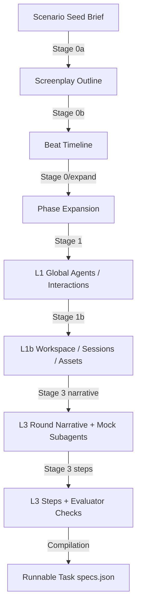

# Gemini 3.5 Flash Data Generation: Model Capability Analysis & Failure Modes

This document analyzes the **systemic model-capability limitations** exhibited by
**Gemini 3.5 Flash** when it is used as the core *generator* for the Computer-Use Agent
Harness conflict-VLM (`conflict_vlm_v1`) multi-round conflict-scenario data.
The goal is deliberately **general**: it catalogs the *classes* of mistake the
model makes during generation (with quantified evidence from a representative
run), the *root cause* in the model's behaviour, and the *seed-agnostic*
safeguards the harness now applies so those mistakes stop wasting retries or
dropping otherwise-valid scenarios. These patterns recur across seeds and
scenario families, so the analysis and the mitigations are written to apply to
**future seeds and new scenario types**, not just the ones observed.

> [!IMPORTANT]
> **Scope boundary — what this document is NOT about.** Some generation-time
> failures look like model mistakes but are actually *harness/spec bugs*. The
> most important example is the `run_script` / `decompress_archive` /
> `execute_db_query` "invalid command" rejections. Those were **our** bug (an
> MCP-verb vs. CLI-token mismatch in `AgentToolSpec`), not a Flash limitation —
> the model followed the advertised tool *syntax* faithfully. They are fixed at
> the harness layer (see §5, "D1") and are **explicitly excluded** from the
> model-capability taxonomy below. Do not re-file them as model issues.

> [!NOTE]
> **Provenance & role boundary (read before comparing to the solver docs).**
> - **This is the *generator* role.** It analyzes Flash *authoring* benchmark data.
>   Flash *solving* the benchmark is a separate analysis with its own, unrelated
>   taxonomy (`F1…`): see
>   [`gemini-3-5-flash-solver-failures.md`](./analysis_v8/gemini-3-5-flash-solver-failures.md)
>   and the [capability & failure-mode analysis](./analysis_v8/eval-results-capability-analysis.md).
> - **The counts below are generation-run counts** from one representative
>   **30-scenario × 10-version** run (**300 rounds**); "6/30 scenarios",
>   "43/300 rounds", etc. refer to *that* generation run and are **left as-is** —
>   they are not the solver-eval suite.
> - **The solver-eval suite has since been rebuilt (60 scenarios × 10 rounds =
>   600 tasks) and re-run on a command-matching-fixed harness.** That newer run
>   *reversed* several **solver-side** conclusions about Flash: it grounds, and its
>   headline `invalid_command_exhausted` terminations turned out to be a
>   **harness command-matching bug** (the action-DSL parser rejecting Flash's
>   recoverable syntax), since fixed — they collapsed from **393 to 1**. Its real
>   dominant solver failures are **content-wrong submissions and step-capped
>   loops**, not "never opens / gives up" and not an output-layer instability. None
>   of that changes the **generation** taxonomy (M1–M14) here — the two roles are
>   independent and were measured on different runs.

---

## 1. The Generation Pipeline (why format/logic drift is fatal)

The CLASHarness conflict-VLM line uses a seed-guided, multi-stage LLM pipeline to produce complex,
*executable* multi-round benchmarks:



At every stage Flash is called in structured-JSON mode to fill an outline or
content slot. Because the pipeline **compiles to executable tasks**, any format
drift, symbol drift, or logical contradiction at any stage can invalidate the
whole scenario. Each stage runs inside a bounded **retry loop** that feeds the
validation error back to the model as feedback; a class of mistake matters in
proportion to (a) how often it fires and (b) whether the model can self-correct
from the feedback, or whether it loops until the retry budget is exhausted and
the scenario is dropped.

---

## 2. Taxonomy of Model-Capability Failures

Counts below are from one representative 10-version generation run
(`gemini-3.5-flash`, `temperature=0.4`, `target_rounds=10`) and are used as
*evidence of frequency*, not as a fixed spec — the point is that these classes
recur.

### M1 — Visible asset-ID leakage into instructions  *(observed 11×)*
* **Failure**: The round instruction names an *internal* asset identifier that
  the solver can never see. The agent only perceives assets rendered in the
  platform UI (screenshots/charts with captions); it has no access to the
  generator's internal IDs.
* **Evidence**:
  `Instruction leaks visible asset ID: 'devops_dashboard_database_latency_chart'`
  `Instruction leaks visible asset ID: 'workspace_ci_cd_pipeline_logs'`
* **Capability limitation**: Flash treats its own scratch identifiers as if they
  were shared vocabulary; it fails to distinguish "names I invented while
  authoring" from "names the player can reference".

### M2 — Trajectory under-planning (too-short reference solutions)  *(observed 7×)*
* **Failure**: The compiled reference trajectory has fewer than the required
  minimum steps (< 4), collapsing the intended
  *Discovery → Inspection → Wait → Action → Verification* workflow into 2–3
  steps that skip inspection/verification.
* **Evidence**: `Steps trajectory too short: 3 steps. Must be at least 4 steps.`
* **Capability limitation**: This is a genuine **reasoning-depth** gap. Under a
  large context the model shortcuts to the final action and omits the
  investigative steps a correct solution requires. Unlike the others, this is
  **not** auto-fixable — a fabricated filler step would make the reference
  solution *wrong*; it can only be retried (and often is not fully recovered).

### M3 — Missing `content` for created workspace files  *(observed 6×)*
* **Failure**: A `workspace_adds` / workspace file entry supplies a `path` but
  omits `content`, most often for legitimately *empty* artifacts.
* **Evidence**:
  `File 'reports/.gitkeep' missing 'content'`,
  `File 'config_checksum.txt' missing 'content'`
* **Capability limitation**: The model conflates "this file is empty / a
  placeholder" with "omit the content field", instead of emitting `content: ""`.

### M4 — Subagent `state_effects` structural & key drift
* **Failure**: Mock-subagent effects are emitted as deeply nested,
  inconsistently-keyed dicts that the runtime does not recognize, so the
  intended file writes / commands **never fire** — meaning the corresponding
  `file_check` / `command_check` cannot pass *even for the reference solution*.
* **Shape the model emits** (vs. the two forms the runtime applies — a raw CLI
  string, or `{"type": "file_create"|"file_write", ...}`):
  ```json
  {"subagent_name": "system_admin",
   "trigger_conditions": {"message_contains": ["restart"]},
   "state_effects": [
     {"effect_type": "file_write", "path": "config/x.json", "content": "..."},
     {"effect_type": "command_execution", "command": "system gateway restart"}]}
  ```
  Drift includes `effect_type` vs `type`, `file`/`filename` vs `path`,
  `command_execution` wrappers, and nested effect lists.
* **Capability limitation**: Flash improvises plausible-but-unspecified schema
  variants for a semi-structured field rather than adhering to the two supported
  runtime forms.

### M5 — `dependency_steps` returned as dicts instead of strings
* **Failure**: `dependency_steps` entries are structured dicts
  (`{"step": "..."}`, `{"action": "...", "command": "..."}`) where plain
  strings are expected. Joining them raised
  `TypeError: sequence item 0: expected str instance, dict found` and discarded
  the **entire** scenario.
* **Capability limitation**: Inconsistent adherence to a declared element type
  inside a list field.

### M6 — Entity / name drift (first name vs canonical ID)
* **Failure**: The same participant appears as `Devon` in a screenplay beat but
  must be `Devon_Operations_Coordinator` in delegate commands / checkers. Drift
  makes the solver delegate to an unregistered agent, or makes the checker look
  for a name the environment never registered.
* **Capability limitation**: Flash struggles to hold strict symbolic references
  when translating natural-language outlines (where first names are natural)
  into formal identifiers across stages.

### M7 — Empty core fields under nested schemas
* **Failure**: As output schemas grow more nested, Flash fills *peripheral*
  arrays (e.g. `capabilities`, `private_knowledge`) while leaving *core*
  identifiers empty:
  ```json
  {"agent_role": "", "mock_response": "",
   "capabilities": ["routing_deployment_rollback"],
   "private_knowledge": ["Requires DB writes unlocked before rollback."]}
  ```
* **Capability limitation**: Attention to structural completeness degrades as
  nesting/context depth increases.

### M8 — Tool-capability overreach when shell access is NOT granted
* **Failure**: For seeds whose `allowed_tool_families` **exclude**
  `shell_scripting`/`run_command`, the model still authors instructions that
  require the *player* to run scripts / compute checksums
  (e.g. *"execute `python decrypt.py` to get the key"*), producing an
  unsolvable task.
* **Capability limitation**: Reliance on a generic "developer agent" prior;
  difficulty respecting **negative** capability constraints.
* **Note**: This is distinct from the `run_script` *harness bug* (see the
  callout at the top / §5-D1). M8 is about seeds that genuinely lack shell
  access; the harness bug was about seeds that *had* it being wrongly rejected.

### M9 — File-path desynchronization
* **Failure**: The steps/checker stage invents a path that the workspace stage
  never created (e.g. workspace adds `config/edge_proxy.yaml`, but the checker
  targets `reports/incident_timeline.md`), so a correct edit scores as a miss.
* **Capability limitation**: Weak cross-referencing of earlier stage outputs as
  hard constraints during later code generation.

### M10 — Reference solution fails its own evaluation checks (self-inconsistency)  *(observed 98 / 300 rounds)*
* **Failure**: The model authors an evaluation check demanding an end-state that
  its *own* reference trajectory never produces — so the ground-truth solution
  scores as a miss when replayed in the real environment, making the check
  impossible for any solver to pass fairly. Two dominant shapes:
  * **file_check without the mutation** *(63 rounds)*: e.g.
    `payment_chargeback_dispute_v06_r04` compiles a
    `file_check configs/signature_config.json contains "\"status\": \"active\""`,
    but the expert trajectory only does *asset open → message → file read* and
    never writes `status: active` (nor runs anything that would).
  * **messages_sent semantic mismatch / empty** *(36 rounds)*: the reference
    message does not satisfy the model's own `field_semantic_match` criterion, or
    the round emits no message effect at all. Judge verdicts (gemini-3.5-flash)
    on `incident_commander_selection_v05`:
    *"The content does not contain a request to Casey to unlock database writes
    citing stable active and idle connection metrics"*; *"The content is empty …
    no evidence of a dashboard status refresh"*.
* **Capability limitation**: Flash authors the *checker* and the *reference
  trajectory* in separate stages and does not enforce that the trajectory it
  wrote actually satisfies the criterion it wrote. This is a **cross-stage
  self-consistency** gap — stronger than M9 (which is path naming): here even
  when paths agree, the *content/semantic post-condition* is never established by
  the reference steps.
* **Scope note**: These counts are the residue **after** the `run_script` harness
  bug (D1) is fixed. D1 previously masked much of this by failing the
  `command:run_script` check first; with D1 fixed, run_script rounds run to
  completion and expose the underlying trajectory/checker inconsistency.
* **Update — now structurally mitigated at authoring time.** The round
  micro-pipeline now derives graders in code from the actual command trajectory and
  pins a decisive `resolved_value` (see the pipeline doc's "Round Solvability" §C —
  `_scaffold_round_checkers` + the Resolution sub-call), which prevents the two
  dominant shapes above *by construction* rather than detecting them after the fact.
  The simulation replay remains the diagnostic safety net for residual cases.

### M11 — Generated helper scripts hardcode non-workspace (absolute/host) paths  *(observed in file_check residue)*
* **Failure**: A model-authored script targets an absolute host path that does
  not map to the workspace-relative file the trajectory creates, so the script is
  a silent no-op and the mutation its checker expects never happens. Example —
  `scripts/reload_config.sh`:
  ```bash
  CONFIG_FILE="/configs/signature_config.json"   # absolute host path
  # ... sed -i 's/"status": "error_invalid_passcode"/"status": "active"/' "$CONFIG_FILE"
  ```
  while the trajectory does `file create --path configs/signature_config.json`
  (workspace-relative). At runtime the script prints
  `[ERROR] Configuration file /configs/signature_config.json not found!` and the
  `sed` that would flip `status → active` never runs → the `file_check` fails.
* **Capability limitation**: Flash reaches for a conventional Unix absolute path
  inside authored scripts rather than the sandbox's workspace-relative
  convention, and does not cross-check the script's path against the paths its
  own trajectory manipulates. (A subclass of M10's self-inconsistency, specific
  to *inside-script* logic.)

### M12 — Path-like / doubled asset IDs (platform + path segments baked into the id)  *(observed 45 ids across 6 / 30 scenarios)*
* **Failure**: The model emits an asset `id` that is really a *file path* — it
  bakes the platform name, directory segments, and sometimes the extension into
  the id (`ops_dashboard/assets/devops_dashboard.png`, `workspace/flight_schedule`).
  When the pipeline then prefixes the id with the platform basename to satisfy
  the `{platform}_` naming convention, the result is a **doubled, slash-bearing**
  phantom: `ops_dashboard_ops_dashboard/assets/devops_dashboard.png`,
  `workspace_workspace/flight_schedule`. That id never matches the clean,
  timestamped snapshot id the solver actually sees, so an `assets_accessed` check
  scoped to it is ungradeable.
* **Evidence** (representative run): 45 slash-bearing ids across 6/30 scenarios;
  `multimodal_temporal_conflict_01_v05` had **all 13/13** assets in this shape,
  `payment_chargeback_dispute_v03` **20/20**, plus partial in `v07-ics`,
  `v02-mtc`, `v04-pcd`, `v06-pcd`.
* **Capability limitation**: Flash conflates "asset identifier" with "filesystem
  path", copying path/extension structure into a field that must be a bare slug.

### M13 — Filename or reserved word used as `platform_id`  *(observed 23× in one scenario)*
* **Failure**: `platform_id` must name a web-UI surface (a bare lowercase slug),
  but the model emits a *filename* (`routing_topology.png`) or a *reserved
  authoring word* (`workspace`, `assets`, `chart`). A filename platform then
  propagates into asset ids/paths
  (`routing_topology.png_routing_topology.png/routing_topology_diagram`); a
  reserved word collides with the harness's own vocabulary and yields the M12
  doubling (`workspace_workspace/...`).
* **Evidence**: `incident_commander_selection_v07` carried
  `platform_id="routing_topology.png"` on 23 assets; `payment_chargeback_dispute_v04`
  used `platform_id="workspace"` throughout.
* **Capability limitation**: The same author-vs-schema confusion as M12 — the
  model reaches for the nearest concrete noun (the file it is describing) instead
  of naming the abstract UI surface, and does not respect reserved tokens.

### M14 — Duplicate bare + timestamped snapshot ids with phantom early-availability
* **Failure**: The prompt asks for **exactly one id per snapshot**, but the model
  emits *both* a bare id (`workspace_flight_schedule`) and one-or-more timestamped
  twins (`workspace_flight_schedule_20231027_105230`) for the same visual — and
  sometimes a third path-like phantom (`workspace_workspace/flight_schedule`).
  Worse, the bare/phantom twin carries an **unreliable `available_from_round`**
  (usually 1) even though the real snapshot first appears much later. An
  `assets_accessed` check scoped to that id is then graded in a round where *no*
  snapshot of the visual exists yet — impossible to pass, unfairly lowering
  scores.
* **Evidence**: `payment_chargeback_dispute_v04` — phantom
  `workspace_workspace/flight_schedule` declared `available_from_round=1` while
  the real snapshot `workspace_flight_schedule_20231027_105230` is round **2**;
  phantom `workspace_workspace/telemetry_dashboard_chart` declared round 1 while
  the earliest real telemetry snapshot is round **4**.
* **Downstream residue — dangling asset-reads & orphan checks**: the same phantom /
  bare twin id does not only break an `assets_accessed` check — it also leaks into
  the **reference trajectory**. The compiled `solution_commands` / `expert_trajectory`
  carry a pure-read `asset {open,info,read-text,describe} --id <phantom>` for a
  snapshot that does not exist in that round, so the reference solver hits "Asset not
  found" and the read is a silent no-op; a `command_check` scoped to that same command
  is then an **orphan** that can never pass. Across the 30-scenario dataset this residue
  measured **57 dangling reads in `solution_commands`, 57 in `expert_trajectory`, and 2
  orphan `command_check`s** (43/300 rounds across 15/30 scenarios) before reconciliation.
* **Capability limitation**: Flash does not maintain a 1:1 snapshot↔id mapping
  across stages, and it fabricates temporal metadata (`available_from_round`) for
  ids it invented rather than deriving it from when the snapshot actually exists.

---

## 3. Root-Cause Themes

| Theme | Description | Why it produces the above |
| --- | --- | --- |
| **Semi-structured field improvisation** | For loosely-typed fields (`state_effects`, `dependency_steps`) the model invents schema variants. | M4, M5, M7 |
| **Reasoning-depth shortcutting** | Under long context the model jumps to the terminal action. | M2 |
| **Author-vs-player confusion** | The model does not separate its private authoring vocabulary/capabilities from what the solver can see or do. | M1, M6, M8 |
| **Weak cross-stage constraint tracking** | Earlier-stage outputs are not treated as hard constraints later. | M6, M9, M11 |
| **Reference/checker self-inconsistency** | The trajectory the model writes does not satisfy the checker the model writes (content/semantic post-condition never established). | M10, M11 |
| **Path/identifier confusion** | The model bakes file paths, filenames, and extensions into fields that must be bare slugs (asset `id`, `platform_id`), producing doubled/slash-bearing phantoms. | M12, M13 |
| **Snapshot-identity & temporal drift** | No 1:1 snapshot↔id mapping; duplicate bare+timestamped ids for one visual, with fabricated `available_from_round` on the invented/bare twin. | M14 |
| **Validation timing (harness-side)** | Historically some checks fired only at final compile, denying the retry loop a chance to self-correct in-stage. | amplifies all |

---

## 4. Which failures are auto-fixed vs. retry-recoverable vs. residual

| Issue | Harness strategy | Outcome |
| --- | --- | --- |
| M1 asset-ID leak | **Auto-sanitize** in place (rewrite ID → neutral phrase) | Eliminated as a hard failure |
| M3 missing content | **Coerce** missing/None → `""` | Eliminated as a hard failure |
| M4 state_effects drift | **Normalize/flatten** to runtime forms | Effects now fire; checks passable |
| M5 dependency dicts | **Coerce** dict → string | No longer discards scenario |
| M6 name drift | In-prompt **entity registry** + in-loop validation | Mostly prevented; else retried |
| M7 empty core fields | **Immediate in-loop validation** with feedback | Retried and usually recovered |
| M8 overreach (no shell) | **Negative-capability prompting** | Mostly prevented |
| M9 path desync | Path validation / cross-stage checks | Retried |
| M2 under-planning | Minimum-step validation → **retry only** | **Residual** (reasoning-depth; not auto-fixable) |
| M10 GT fails own checks | **Structural**: code-owned checker scaffold + decisive-value resolution layer derive graders from the actual trajectory (`_scaffold_round_checkers`; pipeline §C); simulation replay (`failed_tasks.json`) kept as diagnostic net | **Mitigated** (dominant shapes prevented at authoring time; residual cases still caught by replay) |
| M11 script absolute paths | Same simulation replay surfaces the no-op | **Residual** (subclass of M10) |
| M12 doubled path-like ids | **Auto-sanitize**: drop leading `{platform}/` segment, fold residual `/`→`_` before prefixing (A1); base-key fold at grading (A2) | Eliminated at generation; legacy data folds at grade time |
| M13 filename/reserved platform | **Auto-sanitize + remap**: strip dir/extension, reject blocklist, remap onto scenario vocab (`_sanitize_platform_id`) | Eliminated as a source of doubling |
| M14 bare+timestamped phantom availability | **Effective-availability** defers a bare id to its earliest timestamped sibling's round (A1); base-key dedup collapses twins; **compile-time reconciliation** rewrites pruned-twin ids and drops dangling asset-reads from the trajectory, dropping any paired `command_check` in lock-step (P1/P1b) | Phantom hidden until a real snapshot exists; trajectory + checks reference only assets visible that round |

The design principle: **prefer deterministic normalization/sanitization over
retries** wherever a mistake is mechanically recoverable (M1, M3, M4, M5),
because retries cost API calls and sometimes exhaust the budget and drop the
whole task. Reserve retries for mistakes that require the model to *think again*
(M2, M6, M7, M9). This keeps the fraction of dropped/deficient tasks low without
lowering the quality bar.

---

## 5. Harness Remediations (seed-agnostic)

1. **Negative-capability prompting (M8).** When `shell_scripting`/`run_command`
   is not in the seed's allowed families, inject an explicit constraint:
   *"the coordinator does NOT have terminal access … MUST NOT design actions
   that require running scripts/decryption/checksums; delegate to a subagent or
   allow a config edit instead."*
2. **Entity mapping registry (M6).** Compile a `{"Devon":
   "Devon_Operations_Coordinator", …}` map and feed it into every downstream
   stage prompt, forcing canonical identifiers.
3. **Immediate in-loop validation (M7, M1, M2, M9).** Move structural/semantic
   checks *inside* each stage's retry loop so the model gets error feedback and
   can self-correct in-stage rather than failing only at final compile.
4. **Content coercion — "D3" (M3).** `_validate_workspace_paths` defaults a
   missing/None `content` to `""` (and stringifies non-str payloads) so empty
   placeholders materialize instead of aborting.
5. **Asset-ID sanitization — "D4" (M1).** `_validate_generated_round_narrative`
   rewrites any leaked asset ID to a neutral, id-free noun phrase
   ("the attached screenshot/document/…") in place, with a safety net that still
   fails loudly if anything survives sanitization.
6. **Subagent-effect flattening — "B3" (M4).** `_flatten_subagent_state_effects`
   (and companions) recursively normalize nested/mis-keyed effects into the two
   runtime-supported forms and drop conflicting duplicates.
7. **Dependency coercion — "A" (M5).** `_coerce_dependency_step` maps dict
   entries to their best string field instead of crashing the join.
8. **Asset-ID path/prefix normalization — "A1" (M12, M13).**
   `_normalize_and_prefix_assets` now (a) sanitizes `platform_id` via
   `_sanitize_platform_id` — strips directory/extension, rejects a blocklist of
   reserved words (`workspace`, `assets`, `chart`, …) and filename-shaped values,
   and remaps out-of-vocabulary values onto the scenario's platform vocabulary;
   and (b) before prefixing, drops a leading `{platform_basename}/` segment and
   folds any residual `/`→`_`, so an id can never become the doubled,
   slash-bearing phantom (`ops_dashboard/assets/x.png → ops_dashboard_assets_x.png`).
9. **Base-key folding for grading parity — "A2" (M12, M14).** `_asset_base_key`
   (materializer) and `_normalize_asset_base` (effect_checker), kept in sync,
   both strip the `_YYYYMMDD_HHMMSS` timestamp, `_r<N>`, and trailing `_chart`,
   and additionally fold a doubled `tok_tok/` prefix and residual `/`→`_`. A
   legacy phantom (`workspace_workspace/flight_schedule`), the bare id
   (`workspace_flight_schedule`), and the timestamped snapshot
   (`workspace_flight_schedule_20231027_105230`) all collapse to one base key, so
   compile-time reconciliation and runtime `assets_accessed` grading agree **even
   on already-generated data**.
10. **Effective snapshot availability — "A1" (M14).**
    `_effective_available_from_round` treats a bare id that has timestamped
    siblings as available only from the *earliest* sibling's round instead of
    trusting its (often wrong) declared round, and is wired into both per-round
    visibility sites. Phantom/bare ids are hidden until a real snapshot exists; a
    genuinely lone asset (e.g. an r1 login map) is untouched. Verified on
    `payment_chargeback_dispute_v04`: phantom flight r1→r2, telemetry r1→r4 (both
    hidden at round 1), genuine customer_login_map stays visible.
11. **File-content check robustness — "A3" (reduces M10/M11 residue).**
    `FileChecker` `contains`/`equals` now compare with case-folding and
    whitespace normalization, so a reference mutation that differs from the
    checker only by trivial formatting no longer scores as a false miss.
12. **Compile-time trajectory/check id reconciliation — "P1/P1b" (M14).** During
    materialization each round's reference commands and checks are reconciled against
    that round's post-dedup **visible** manifest (same `_effective_available_from_round`
    + base-key dedup as grading). `_reconcile_solution_command_asset_ids` (solution /
    expert trajectory) and `_reconcile_asset_checks` (`assets_accessed` +
    `command_check`) both delegate to the shared `_reconcile_asset_command_id`, so a
    command and the check that grades it always make the **same** decision about the
    same id: a read whose id names a visible asset is kept; a pruned bare-twin id is
    **rewritten** to the canonical visible id (P1); an id that resolves to *no* snapshot
    visible this round is a dangling read and is **dropped** (P1b), and any paired
    `command_check` is dropped in **lock-step** so no orphan grader survives. A guard
    restores the originals in the pathological case where every command in a round was a
    dangling read. Verified on the full 30-scenario dataset: on-disk danglers went from
    **57 / 57 / 2** (`solution_commands` / `expert_trajectory` / `command_check`) to
    **0 / 0 / 0**, with every instruction and asset byte preserved.

> **D1 (harness spec bug, NOT a model remediation).** The `run_script` /
> `decompress_archive` / `execute_db_query` rejections were fixed by
> canonicalizing the advertised MCP verb to its CLI form in the single
> normalization layer shared by the generator's validator and the runtime
> (`rewrite_command`). Listed here only so it is not confused with a
> model-capability fix.

> **B (multimodal input presentation, fairness — NOT a model fix).** The default
> `--multimodal-input-mode` is now `both` (was `path`): the solver receives both
> the rendered asset (image) and its textual/path form, so text-anchored and
> vision-anchored checks are both fairly reachable. This changes how assets are
> *presented at eval*, independent of the generation-time model behaviour
> catalogued above.

---

## 6. Key Takeaways for Evaluators

1. **Lightweight generators need restrictive schemas + in-loop validation.**
   Free-form instructions drift; strict validation *inside* the retry loop, with
   error feedback, is what lets the model self-correct.
2. **Normalize what you can, retry what you must.** Mechanical mistakes (leaked
   IDs, empty content, effect/step shape) should be repaired deterministically;
   only reasoning failures should consume retry budget. This is how the fraction
   of problematic tasks is driven down without hand-tuning per seed.
3. **Generation is harder than solving.** Flash can *solve* many tasks, but
   *generating* a coherent multi-round task requires tracking symbolic and
   file-path state across thousands of lines of context — which is where its
   planning/consistency limits show.
4. **Separate model limits from harness bugs.** Before filing a "model can't do
   X", confirm the harness actually accepts a correct X (the `run_script` case
   was a spec bug, not a Flash limitation).
5. **The generation-time simulation replay is currently diagnostic-only.**
   `conflict_vlm_materializer` replays each reference trajectory and records
   rounds whose ground-truth fails its own checks to `failed_tasks.json`, but
   those tasks are **still exported to eval** (they are saved before the replay).
   So M10/M11 rounds reach the final benchmark as unfair tasks. Making the
   pipeline **drop or regenerate** simulation-failed tasks would drive the
   problematic-task fraction down further; this is deferred as a separate product
   decision (the D1 harness fix already cleared the run_script layer: 147 → 98
   problematic rounds out of 300 in the representative run). **Update**: the newer
   Resolution layer + code-owned checker scaffold (pipeline §C) now prevent the
   dominant M10 shapes at authoring time, shrinking the population that would ever
   reach this replay; making the replay itself *drop/regenerate* the residual
   remains the deferred product decision.

---

### Cross-references
- Flash as *solver* (different role, unrelated `F1…` taxonomy): [`gemini-3-5-flash-solver-failures.md`](./analysis_v8/gemini-3-5-flash-solver-failures.md)
- Results overview & ladder (600-task solver run): [`eval-results-capability-analysis.md`](./analysis_v8/eval-results-capability-analysis.md)
- Cross-model behavioral comparison: [`cross-model-behavioral-comparison.md`](./analysis_v8/cross-model-behavioral-comparison.md)
